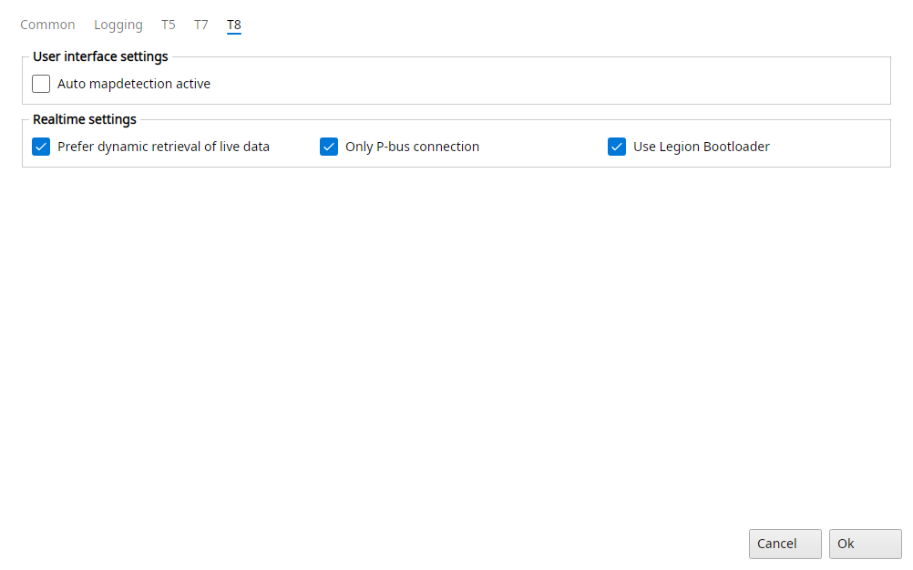

# Trionic 8 settings

The T8 tab of File → Settings has the options only a T8 has.

{#fig-settings-t8 width=100%}

## Settings → T8

### User interface settings

Auto mapdetection active
:   When checked, TxSuite will try to add names to symbols in binaries without symbol tables.
    This is a guesstimate routine.

### Realtime settings

Prefer dynamic retrieval of live data
:   Massive boost to sample rate if the binary is compatible.
    The realtime panel asks the ECU for all its symbols in one list instead of one by one.
    If the ECU doesn't take the list, TxSuite reads them one by one for the rest of the session.

Only P-bus connection
:   If checked, TxSuite connects to the ECU on the P-bus (500 kbit/s) only.
    If not checked, the Lawicel CANUSB, Kvaser, Just4Trionic and SLCAN adapters connect on a slower bus instead, and only some of them fall back to the P-bus when they find no traffic there.

Use Legion Bootloader
:   When checked, TxSuite reads, flashes and recovers the ECU with the Legion bootloader, which only erases and writes the partitions that differ from the file.
    If not checked, the default bootloader is used.
