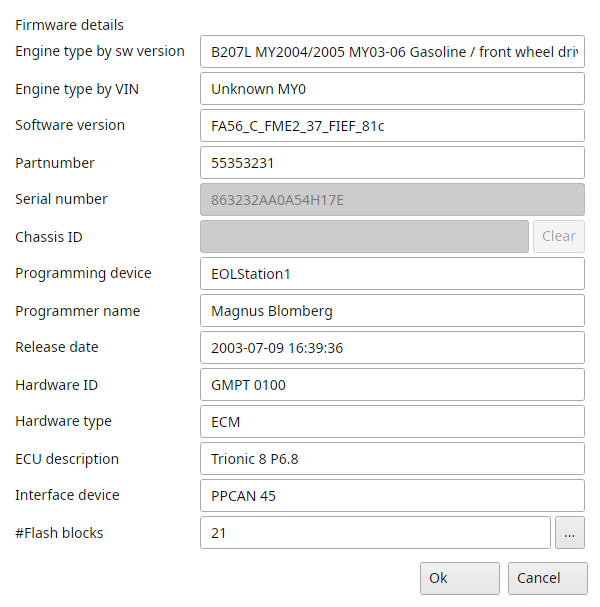

# Firmware information

Actions → Firmware information shows the information stored in the current binary file.
Ok writes the changes and checks the checksum the way opening a file does, Cancel leaves the file alone.
In a project the changes are transactions in the project's log.

{#fig-firmware-t8 width=60%}

Engine type by sw version
:   The engine, model year and car the software version belongs to.

Engine type by VIN
:   The engine, model year and gearbox decoded from the chassis ID.

Software version
:   The software version of the binary.
    Double-click its caption to change it.

Partnumber
:   The partnumber of the software.

Serial number
:   The immobilizer code of this binary file.
    For more information about immo code please refer to the SAAB technical documentation.

Chassis ID
:   Vehicle Identification Number (VIN) for the current binary file.
    Should match your car's VIN number.
    Double-click the Chassis ID or Serial number caption to change the VIN and immobilizer code.
    Clear empties the VIN, Ok writes it.
    Actions → VIN decoder decodes it.

Programming device, Programmer name and Release date
:   Where, by whom and when the software was made.

Hardware ID, Hardware type, ECU description and Interface device
:   What the software was made for.

#Flash blocks
:   How many valid flash blocks the binary has.
    The "..." button opens the Flashblocks browser with each block's number, type, address, VIN, ECU type, interface and secret code.
