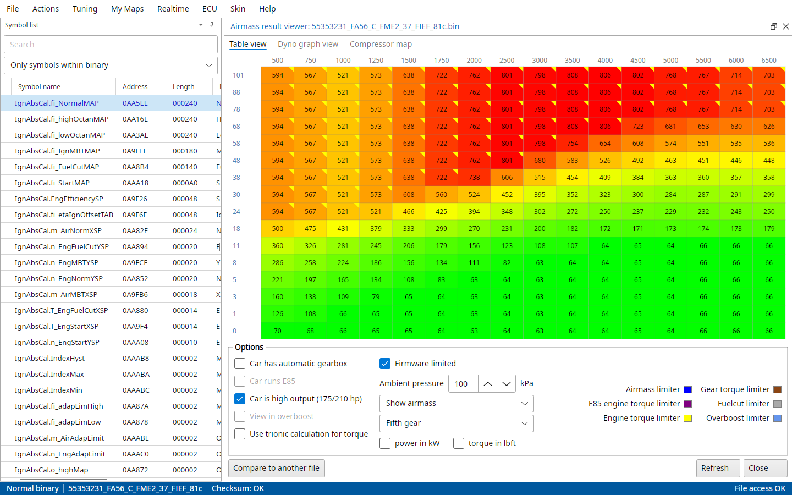
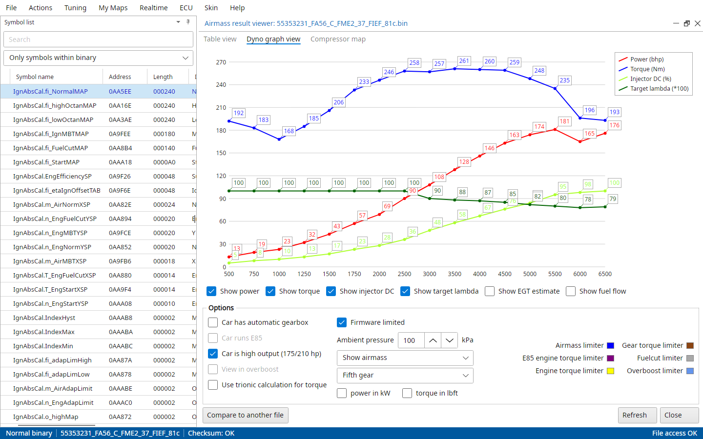
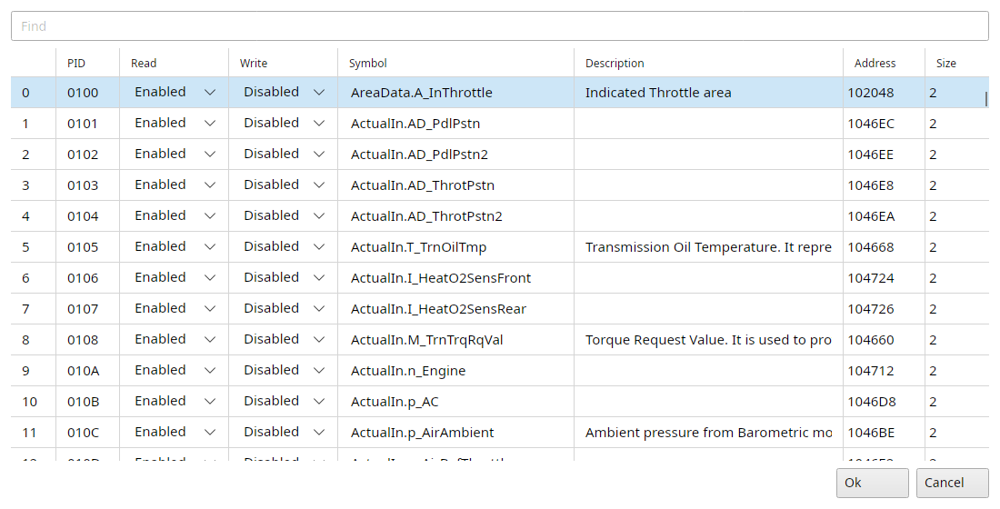
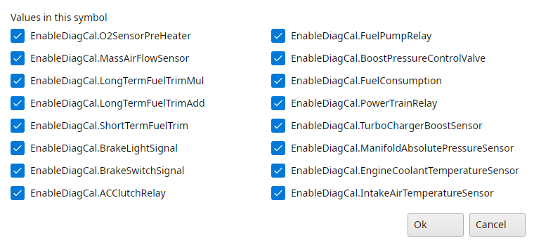

# Trionic 8 tools

The last section of the Actions menu has the tools only a T8 has.

## Actions → Airmass result viewer

TxSuite incorporates a function to verify the final (estimated) airmass results based on the most common airmass and torque limiters.
The result from these calculations are shown in a table that also shows the limiter that is holding more airmass per combustion back.

{#fig-airmass-table-t8 width=100%}

The table has a column per rpm and a row per pedal position, wide open throttle on top.
On a T8 the pedal map is a torque request, which is turned into airmass through TrqMastCal.m_AirTorqMap.
The coloured triangle in a cell's corner is the limiter that holds it back, the legend says which colour is which.
Click a legend entry to open the maps of that limiter.
The values can be shown as airmass, torque, horsepower, injector duty cycle, target lambda or AFR, EGT or fuel flow.
Power in kW and torque in lbft switch the units of the table and the dyno graph.

The options change the calculation: automatic gearbox, E85, overboost, the gear, the ambient pressure, Trionic's own torque calculation, whether the firmware limits it, and "Car is high output (175/210 hp)" for the high output torque tables.
Compare to another file draws a second file over this one, Refresh calculates again after you changed a map.
Maps the binary doesn't have don't limit anything.

{#fig-airmass-dyno-t8 width=100%}

The Dyno graph view tab draws the result at wide open throttle as power and torque curves, optionally with injector duty cycle, target lambda, the EGT estimate and fuel flow.

The Compressor map tab shows where you will land in the compressor map of your turbo with these airmasses.
TxSuite guesses the turbo from the VIN, Select your turbo picks another, and the intake temperature and volumetric efficiency can be set.

## Actions → TEM editor

Edits the binary's TEM table, a list of short labels (max 4 characters) each with the symbol it shows.
Only enabled when the binary has a TEM table, none of the stock binaries has one.
Ok writes every row back into the binary and checks the checksum.

## Actions → PID editor

Edits the binary's PID table: which symbol the ECU gives out under which PID (a 16-bit hex number), and whether it can be read and written (Disabled, Enabled, Secured).
Rows with something wrong are coloured, a symbol in flash can't be writable for example.
The Find box filters the rows.
Ok writes every row back into the binary and checks the checksum.
If you don't know what this is about, please don't use it!

{#fig-pid-editor-t8 width=85%}

## Bit mask symbols

Symbols that are a set of on/off bits (the Bitmask column in the symbol list) open in "Bit masked view of symbol" instead of a map viewer.
It shows the 16 bits, each named by the symbols at the same address, and you tick them on or off.
Ok writes the word into the file, or into the ECU for a symbol that lives in SRAM.

{#fig-bitmask-t8 width=60%}
