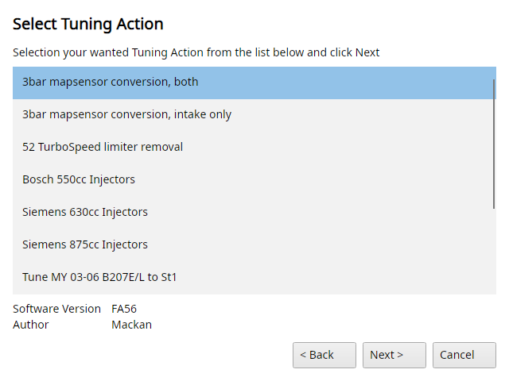

# Tuning menu

The Tuning menu starts with the Tuning Wizard, the rest gives you direct access to the most important maps, grouped in submenus.
Each map entry opens that map of the open file in a map viewer.
An entry only shows when the binary has the map, so the E85 limiters only show on BioPower software and the jerk maps only where the software has them.
Point at an entry to see which symbol it opens.

## Tuning → Tuning Wizard

Lets you apply a pre-defined set of Tuning Actions to your binary file.
The Tuning Actions are the signed `.t8x` packs that come with TxSuite (its `TuningPacks` folder), the wizard only offers the ones that fit your software.

1. Read the welcome page and click Next.
2. Select the Tuning Action you want from the list, with its software version and author, and click Next.
3. Some packs need a code, visit trionictuning.com and learn how to earn the code.
4. The last page says what will be done. The Tuning Action cannot be reverted, tick "I fully understand the consequenses." and click Finish.

TxSuite makes a backup of the binary first, `<bin>-<time>-BACKUP-BEFORE-WIZARD-<pack>.bin`.
Then it applies the pack as File → Import tuning package does, writes the programmer name and release date into the binary and shows the pack's message.

{#fig-tuning-wizard-t8 width=55%}

## Tuning → Airmass

Max airmass map (manual) and (auto)
:   The maximum airmass limiter (BstKnkCal.MaxAirmass and MaxAirmassAu).

Airmass Fuelcut
:   The fuel cut limiter, running more airmass per combustion than this value results in a complete shutoff of fuel.

AirCtrlCal.AirmassLimiter and AirCtrlCal.PRatioMaxTab
:   More airmass limits.

## Tuning → Torque

Nominal torque map
:   Converts airmass per combustion to estimated torque (TrqMastCal.Trq_NominalMap).

Airmass torque map
:   Converts torque to airmass per combustion (TrqMastCal.m_AirTorqMap).

The torque limiters
:   Ambient pressure trq limiter, Trq limit in overboost, Trq limit manual 150hp and 175+hp, Trq limit auto 150hp and 175+hp, Manual gear trq limit, and on BioPower software the E85 limits.

RPM limiter
:   The engine speed (RPM) limiter.

## Tuning → Injectors

Inj. Constant
:   The injector constant, to compensate for different injectors.

Inj. dead time and Inj. dead time (Y)
:   The battery voltage correction of the injection time and its voltage axis.

## Tuning → Fuel

Fuel correction map, Enrichment Petrol and Enrichment E85, Knock fuel map, Injection end angle map, Jerk enrichment petrol and Fuelmaster
:   The fuel maps.

The ST_Enable switches
:   Purge, closed loop (LambdaCal), fuel cut, flex fuel, fuel dynamics and temperature compensation on or off.

## Tuning → Boost

Boost regulation map
:   The boost regulation map (AirCtrlCal.RegMap).

P factor, I factor and D factor
:   The P, I and D factors for the PID controller that handles boost.

The ST_enable switches
:   Boost control and the boost, frompressure and area adaptions on or off.

## Tuning → Ignition

Normal ignition map, High octane map, Low octane map
:   The ignition maps, the ECU moves between them by octane.

MBT ignition map, Fuel cut ignition map, Startup map
:   The ignition for best torque, during fuel cut and while starting.

IgnAbsCal.ST_EnableOctanMaps
:   Switches the octane maps on or off.

## Tuning → Pedal

Pedal position map and Torque request map
:   How the pedal position becomes a torque request.
