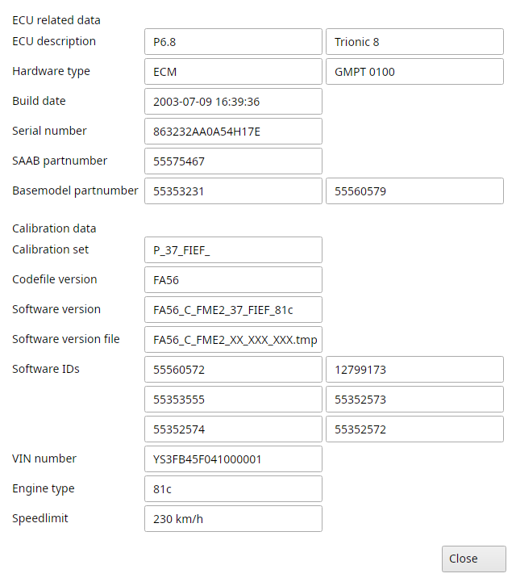

# Trionic 8 realtime

The Realtime menu's items only a T8 has.

When connected the status bar shows "Connected:" with the ECU's software version.
With File → Settings → T8 → Prefer dynamic retrieval of live data the realtime panel reads all its symbols in one go, which is a lot faster.

## Realtime → Get ECU information

Allows you to extract all relevant information from the ECU using the canbus interface: the ECU related data and the calibration data.

{#fig-ecu-information-t8 width=55%}

## Realtime → Clear DTC and knock counters

Lets you clear all DTC's and the knock counters in the ECU.

## Realtime → View knock count map

If connected to a T8 ECU, this will read the knock counter map from the ECU and display it in a map viewer so you can keep track of where (which load/rpm sites) the system has detected knock.

## Realtime → View misfire tab

Reads the misfire counters per cylinder from the ECU and shows them in a map viewer.
