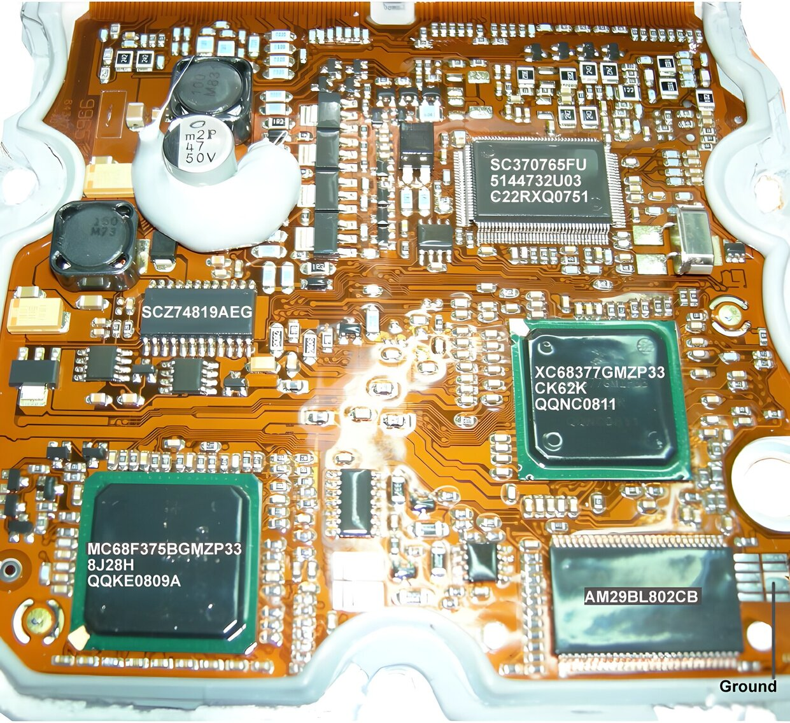

# Hardware {.advanced}

The T8 is build around a Motorola microcontroller (MC 68377).
This is a 32 bit controller that handles the entire motor management including fuel injection, ignition timing and boost pressure control.

The processor has a vast 8Mb (1024 kByte) flash memory (29BL802C) to its disposition for fetching program code and maps.

## Integrated circuit list

The table below lists almost all IC’s on the board.
This is just to give you an idea on what to expect.

| Partnumber       | Function                 | Usage                            | # on board   |
|------------------|--------------------------|----------------------------------|--------------|
| MC68377          | Main microcontroller     | Everything                       | 1            |
| 29BL802C         | Flash memory             | Program storage                  | 1            |

## Datasheets

<!-- TODO roffe: trionic.mobixs.eu is gone, so these two links are dead. Where should the MC68377 and 29BL802C datasheets point now (manufacturer, archive.org, a copy in this repo)? -->

Datasheets can be found on my website:

<http://trionic.mobixs.eu/T8/hardware/MC68377.pdf>

<http://trionic.mobixs.eu/T8/hardware/29BL802C.pdf>

## Block schematic diagram

TODO: Insert block schema for T8 here

## Memory organization

```
0x000000 - 0x01FFFF = boot
0x020000 - 0x0BFFFF = Application software
0x0C0000 - 0x0FFFFF = Unknown
0x100000 - 0x108000 = SRAM
```

## PCB details

The PCB layout is not entirely known of course because SAAB did not release details about this, even in the service manuals.
Finding out how things are setup is not so very difficult though, once you know what the system should do and what hardware components are on the board.

The image will give you some idea on what is what on the board.

{width=95%}

### Power supply
