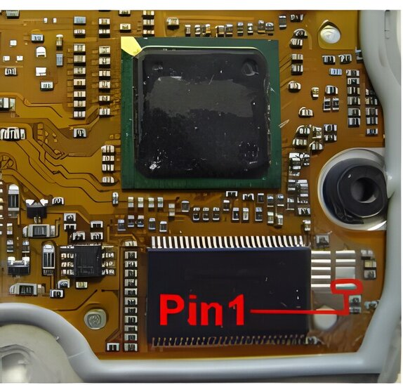
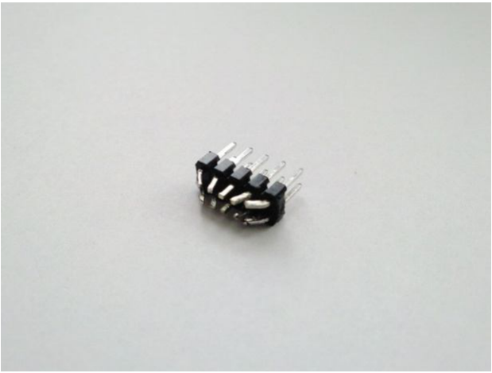
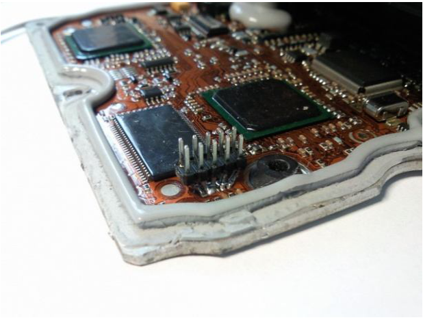
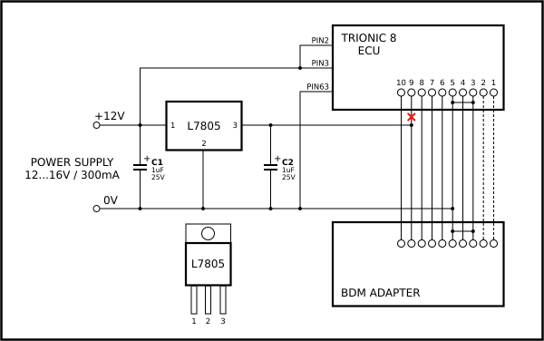
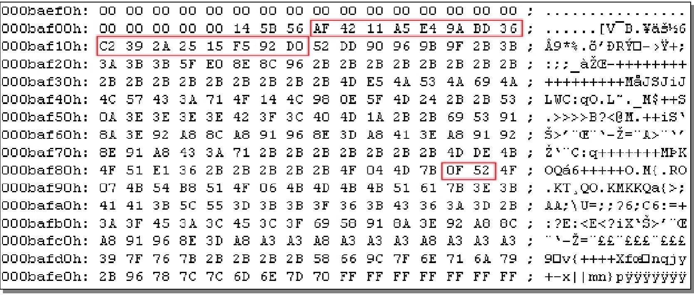

# Flash

Interesting stuff found in the binary file (needs more investigating to clear up)

1. GMPT 0100 indicators found at address 0x004141, 0x006142 (in an aero bin).
   GMPT seems to be short for General Motors Power Train.
   0100 might be a version indicator of some sort.
   Turns out this is an indicator for the hardware (ECU hardware).
2. MFS\* indicators found at 0x000E9Ch, 0x000FDC, 0x004000, 0x006000, 0x0104FE, 0x010758, 0x0107CA and 0x010C1E.
   There seem to be always 8 of these indicators in a T8 file.
3. From 0x004000 (MFS) upto the GMPT 0100 indicator at 0x004141 there seems to be a lot of ASCII information.
   Also from 0x006000 – the GMPT 0100 indicator at 0x006142 there seems to be a lot of ASCII information in the file.
   VIN number, part number, software version may be stored here.
4. SAAI indicators found at 0x00800E 0x00945E, 0x020000 and 0x0200DC.
   The 0x020000 indicator matches the start of one checksum layer area.
5. All symbols seem to be in the area: 0x070000 – 0x0C0000
6. There seems to be some sort of lookup table at or near 0x02C630 – 0x02DEB0 (length ~ 0x1880 = 6272).
   Each entry seems to consist of 8 bytes to 6272/8, so about 784 entries.

```
VIN:      YS3FB45F13104xxxx
MOTOR:    ECM
HW:       GPMT 0100

Info:     869060A70952KL2E
          55354002
          12799173
          55352689
          55352573
          55352574
          55352572
```

## Downloading with ECUProjects USB BDM interface

{width=44%}

{width=44%}

{width=44%}

{width=100%}

## Checksum {.advanced}

### Preface

The Trionic 8 ECU binary images uses several checksums to verify integrity.

Checksum seems to be concentrated at a location given by a pointer \@ address 0x20140.
It is a 4 byte pointer.

In an example binary we find 0x00 0x0B 0xAF 0x06 at 0x20140.
If we scroll to 0x000BAF06 we find a section that has the checksums (verified by comparing binaries).

{width=94%}

The checksum actually consists of two layers.
The first layer is a MD5 hash over the area 0x20000 up to the pointer address (in our case 0x000BAF06).
This hash will be 16 bytes in length.
All bytes in this array are XOR-ed with 0x21 and 0xD6 is subtracted from that value.
This final array is stored in the pointer address + 2 (so, 0x000BAF08 in our example, the large marker in the image).

Once this first layer is correct we can calculate the second layer (not earlier, because the second layer checksum includes the first layers result).
This second layer is calculated over 0x100 bytes ranging from the pointer address (0x000BAF06) up to the pointer address + 0x100 (0x000BB006).

All the bytes (256 in total) are added with 0xD6 and then XOR-ed with 0x21.
In this coded buffer there will be three values 0xFB, 0xFC and 0xFD with an interval of 6 bytes.
For example somewhere in the buffer this sequence will be found.

FB XX XX XX AA AA FC YY YY YY BB BB FD ZZ ZZ ZZ ZZ in which XX and YY are don’t cares.
Once this index is found the XX values will yield a result we will call “*sum*”, the YY values will yield a result we will call “*dimension*” and finally the ZZ values will yield a value that we will call “*fileaddress*”.

If the dimension is larger than 0x020000 we will start reading from the binary file at *fileaddress* until we reach the *dimension* address - 4.
All bytes read will be added and this will result in a checksum value which we will call “*calculated_checksum*”.
Finally we also add the byte at location *dimension* – 1 to the *calculated_checksum*.

We do this again to calculated a second checksum called “*calculated_checksum_2*” but now we add a 4 bytes word every time in stead of a single byte word.
If the upper 3 bytes of the *calculated_checksum* are unequal to the upper 3 bytes of *sum* we make *calculated_checksum* the same value as *calculated_checksum_2*.

If our *calculated_checksum* does not equal *sum* we have an incorrect checksum an it needs to be updated.
This is done by XOR-ing all bytes in *calculated_checksum* with 0x21 and subtracting 0xD6 and writing this result to the XX XX XX XX positions in the previously found buffer.
This is save to file.

Special thanks to “Actitis H.” for all the provided help!

## Firmware {.advanced}

## General

## Memory map {.advanced}

```
0x000000 - 0x01FFFF = boot
0x020000 - 0x0BFFFF = Application software
0x0C0000 - 0x0FFFFF = Unknown
0x100000 – 0x108000 = SRAM
```

## Disassembling the code {.advanced}
