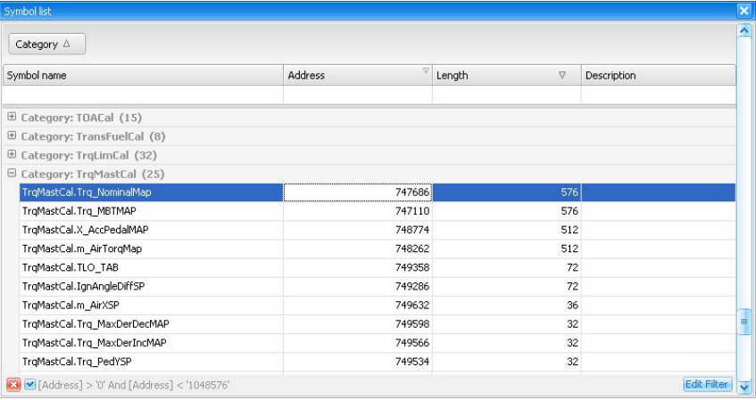
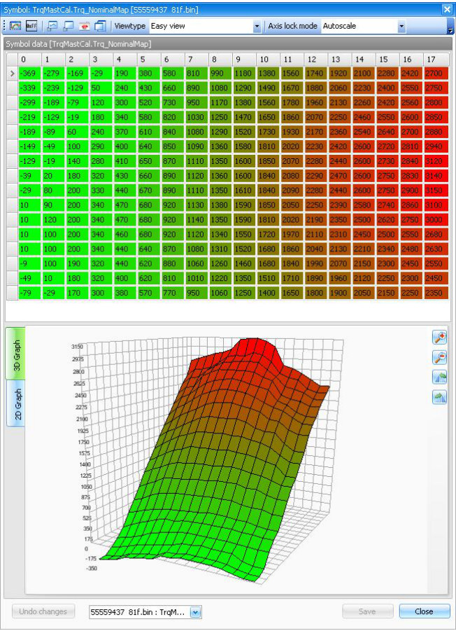

# Symbol tables {.advanced}

## General

Each T8 firmware file contains a symbol table describing data structures in the program.
This table is compressed inside the binary and needs to be extracted and decompressed for parsing.
We actually need these symbol names because they tell us what a certain memory location means.

To save you the time to lookup all addresses manually the T8Suite application will extract all symbol information in one run.
Symbol name, flash address and length will be displayed all together.

The symboltable end address can be found by searching the binary file for the text: “sYMBOLtABLE”.
Just after this address in the file, we can find a pointer for the start of the compressed symboltable like it is shown in the image below.

{width=99%}

This *image* (-@fig-symbol-table) will give you an idea of what the symbol table should look like once it has been extracted and decompressed.
See [appendix I](#sec-appendix-symbol-list) for a complete list of known symbols.

{#fig-symbol-table width=95%}

When the user double clicks one of the symbols that has a flash address attached to it, T8Suite will display the corresponding symbol in a viewer.
This viewer will display the data in table form was well as in graphical form.

{width=48%}
