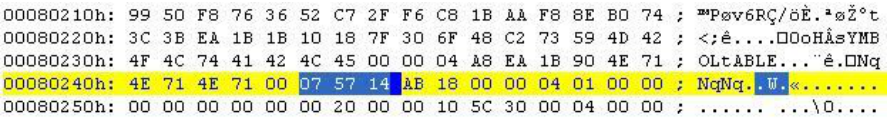
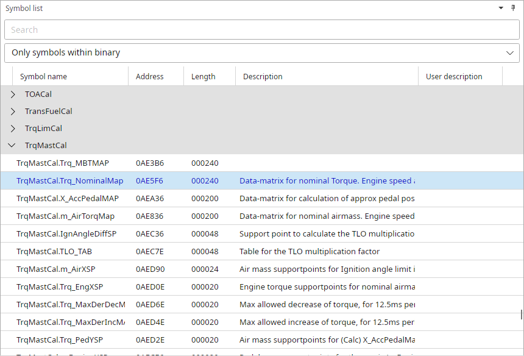
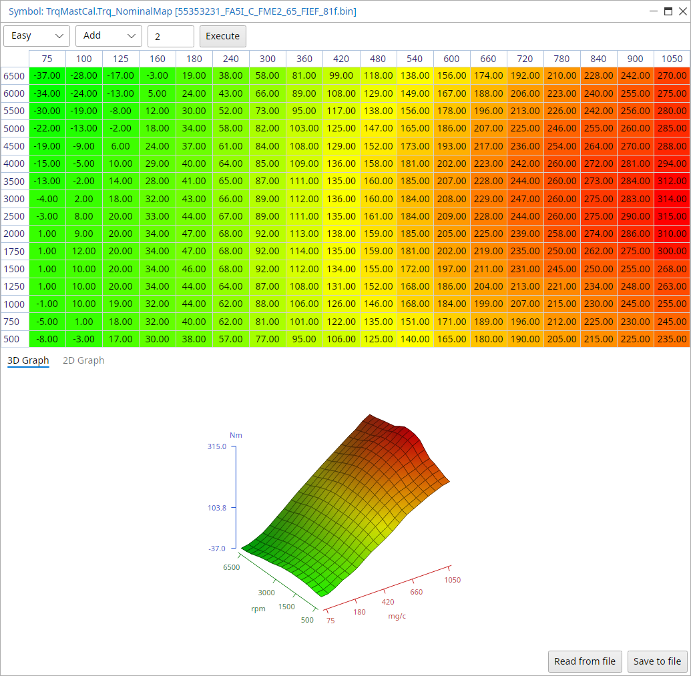

# Symbol tables {.advanced}

## General

Each T8 firmware file contains a symbol table describing data structures in the program.
This table is compressed inside the binary and needs to be extracted and decompressed for parsing.
We actually need these symbol names because they tell us what a certain memory location means.

To save you the time to lookup all addresses manually TxSuite will extract all symbol information in one run when it opens the file.
Symbol name, flash address and length will be displayed all together.

The symboltable end address can be found by searching the binary file for the text: “sYMBOLtABLE”.
Just after this address in the file, we can find a pointer for the start of the compressed symboltable like it is shown in the image below.

{width=99%}

This *image* (-@fig-symbol-table) will give you an idea of what the symbol table should look like once it has been extracted and decompressed.
See [appendix I](#sec-appendix-symbol-list) for a complete list of known symbols.

{#fig-symbol-table width=83%}

TxSuite groups the symbols by category, a category stays folded until you open it or select one of its symbols.
Address and length are hexadecimal, untick File → Settings → Common → Show addresses and lengths in Hex to see them in decimal.

When the user double clicks one of the symbols that has a flash address attached to it, or selects it and presses Enter, TxSuite will display the corresponding symbol in a viewer.
Ctrl+P is the quick way, type any part of a symbol's name and Enter opens it.
This viewer will display the data in table form as well as in graphical form, in the 3D Graph and 2D Graph tabs under the table.
In Easy view, the default, the values are converted to what they mean, here torque in Nm over airmass (mg/c) and rpm.

{width=100%}
