# Maps

## General

A lot of maps in the T8 are not only made up of a piece of raw data.
It also includes x-axis and y-axis information.
TxSuite will automatically display all known axis information when a map is opened.
In Trionic 8 most symbol have an English name (Trionic 5 has lots of Swedish names) that explains lots about its function.
Also, the symbols are caterogised by name, which makes browsing the symbols much easier.
All torque calibration symbols start with “TrqMastCal.”.
TxSuite groups all symbols by their respective category by default, every category starts folded.

## Fuel

Fuel calculation in Trionic 8 is based on the airmass entering the engine.
In rough steps this seems to be the calculation’s flow:

|     | Description                            | Explaination                                          |
|-----|----------------------------------------|-------------------------------------------------------|
| 1   | Basic calculation of fuel quantity per combustion | The current air mass/combustion is divided by 14.7 and sent to box 2. The unit is now in mg fuel/combustion |
| 2   | Compensation                           | In case of a cold engine, shortly after starting, rapid load changes, knocking or high loads, the current value is multiplied by a compensation factor |
| 3   | Closed loop                            | The closed loop value is used as a multiplier. The value is then sent to box 4 |
| 4   | Correction for purge                   | Multiply by the value for purge adaptation. The value is sent to box 5 |
| 5   | Multiplicitive adaptation (long term fuel trim) | The multiplicitive adaptation value is used as a multiplier and the new value is sent to box 6 |
| 6   | Additive adaptation                    | The additive adaptation value is added and the new value is sent to box 7 |
| 7   | Starting fuel quantity                 | If the engine has not yet started, starting fuel is selected. The value is sent to box 8 |
| 8   | Fuel quantity per combustion to be injected | The fuel quantity per combustion is the amount of petrol to be supplied to the engine. The value is sent to box 9 |
| 9   | Injector opening duration              | Converts the value to the time during which the injector must be open and the new value is sent to box 10 |
| 10  | Injection twice per combustion         | Injection takes place twice per combustion until the camshaft position has been found. Injection duration is divided by two. The value is sent to box 11 |
| 11  | Voltage dependant needle lift duration added (battery correction) | Adds the injector time delay, which is voltage dependant. The value is sent to box 12 |
| 12  | Fuel cut                               | The value is sent to box 13 unless fuel cut is active |
| 13  | Activation of injector                 | At a DETERMINED crank shaft angle, the microprocessor will control the transistor for the injector that is next in the firing order |

The basic fuel quantity is calculated based on Airmass and Injector constant.
This injector constant is called InjCorrCal.InjectorConst.

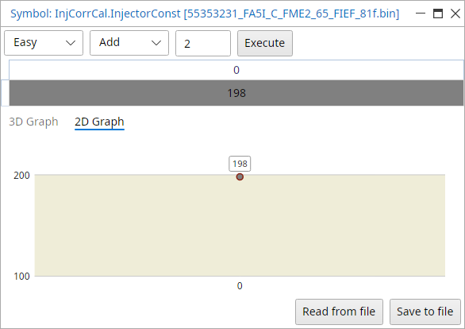{width=57%}

TODO: Insert fuel correction maps here

Battery correction values for injector latency, InjCorrCal.BattCorrTab

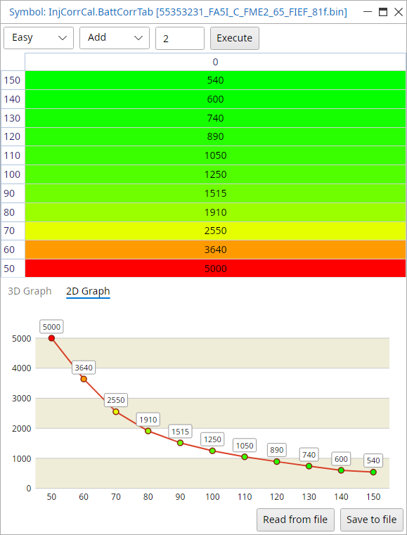{width=56%}

Water temperature correction while starting, StartCal.EnrFacManTab, an enrichment factor over coolant temperature (manual gearbox cars)

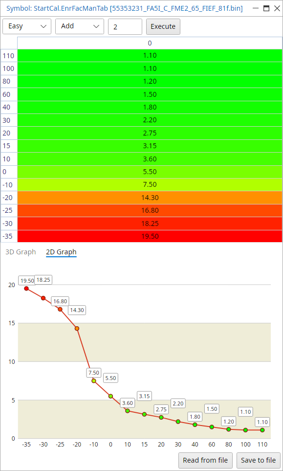{width=56%}

Fuel injection correction map for knock conditions, KnkFuelCal.EnrichmentMap

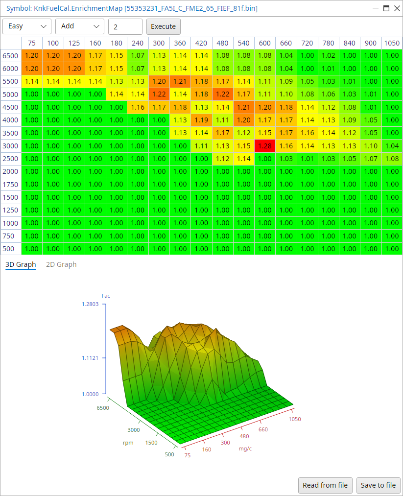{width=80%}

## Ignition

|     | Description                            | Explaination                                          |
|-----|----------------------------------------|-------------------------------------------------------|
| 1   | Idling speed ignition timing           | With idle speed control active, the timing is adjusted to stabilize idle engine speed. The value is sent to box 3 |
| 2   | Normal ignition timing                 | When idle speed control is inactive, the ignition timing is read from a load and engine speed depeding matrix. The value from the matrix is optimized for lowest fuel consumption (best engine torque) and sent to box 3 |
| 3   | Selection of ignition timing           | One of the ignition timing calculation is selected depending on which function is active. The value is sent to box 6 |
| 4   | Catalytic converter heating timing     | In order to heat up the catalytic converter as fast as possible after start, the ignition will be retarded. This is a compensation matrix that is added to the value in box 3. The matrix is dependent on load and engine speed |
| 5   | Engagement of catalytic converter heating timing | The function is active when coolant temperature is above -10 degrees celcius and below +64 degrees celcius |
| 6   | Total                                  | The value from box 5 is added to the value of box 3   |
| 7   | Compensation                           | The ignition timing is corrected depending on engine coolant temperature and intake air temperature. The value is sent to box 6. |
| 8   | Knock control                          | If knocking occurs, a timing retardation will be calculated. The value is sent to box 6 |
| 9   | Total                                  | The compensation angle and knock retardation are totalled to give the current ignition timing. The value is sent to box 7 |
| 10  | Selection of ignition timing           | Starting ignition timing is selected when the engine has not been started. The value is sent to box 9 |
| 11  | Starting ignition timing               | Starting ignition timing is selected when the engine has not yet been started. The value is sent to box 9 |
| 12  | Activate relevant trigger              | At the calculated crackshaft angle, the microprocessor controls the transistor for the trigger that is next in firing order |

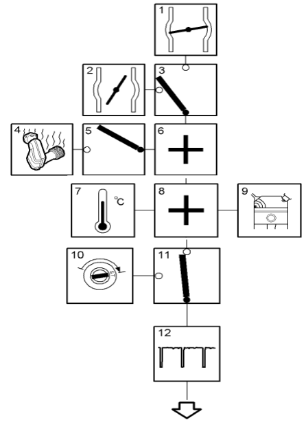{width=36%}

### Ignition coils

Trionic 8 cars don’t use a DI cartridge like T5 and T7 do.
It uses seperate ignition coils for each cylinder.

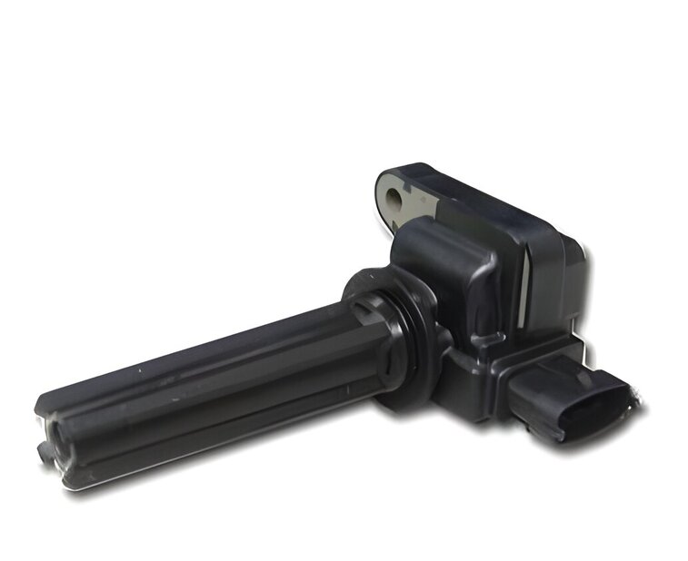{width=58%}

| Pin    | Description                                                            |
|--------|------------------------------------------------------------------------|
| 1      | B+ (positive supply voltage)                                           |
| 2      | B- (negative supply voltage, ground)                                   |
| 3      | Ignition trigger signal from ECU                                       |
| 4      | Ionization voltage (knock, combustion and missfire detection)          |

### Idle control

TODO: Insert ignition idle control map here

### Normal mode ignition

Ignition is normally controlled by the main ignition matrix: IgnAbsCal.fi_NormalMAP

{width=86%}

For high octane fuel the map IgnAbsCal.fi_highOctanMAP will be used, in the stock binary in the picture it holds the same values as the normal map, not every binary has them the same

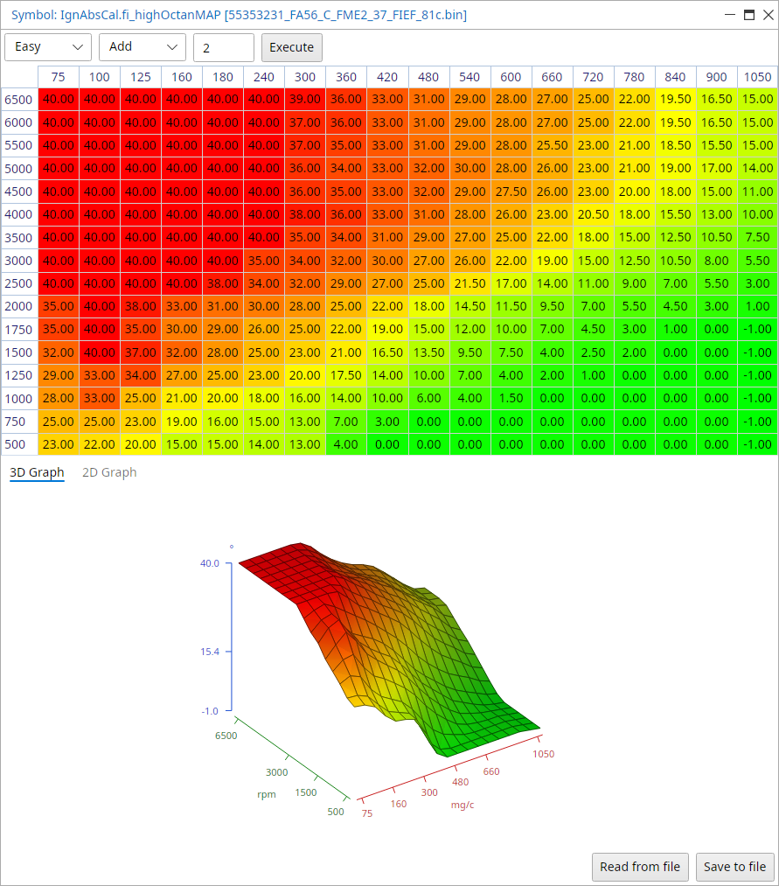{width=86%}

And for low octane fuel the map IgnAbsCal.fi_lowOctanMAP

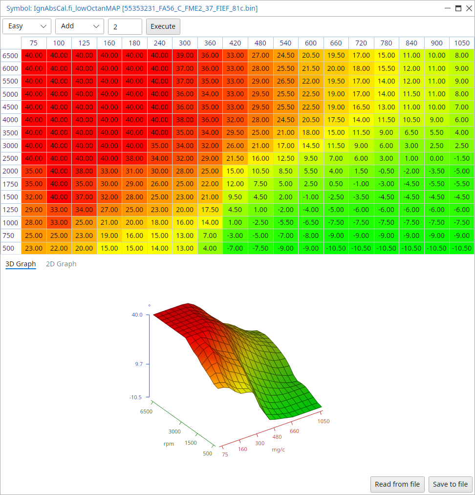{width=94%}

## Torque

Trionic 8 is a torque/airmass request system in stead of a boost request system like Trionic 5 is.

The basic procedure for the airmass controller is like in the table below.

|     | Description                  | Explaination                                                    |
|-----|------------------------------|-----------------------------------------------------------------|
| 1   | Driver request               | The control module reads pedal potentiometer 1 and converts the voltage to air massper combustion (mg/c). The value is sent to box 3 |
| 2   | Cruise control request       | When cruise control is active, the air mass per combustion required to maintain the set speed is calculated. The value is sent to box 3 |
| 3   | Select highest value         | The control module selects the higest of the two values (box 1 or box 2). The value is sent to box 5 |
| 4   | Engine torque limitation     | The maximum permissable air mass per combustion varies depending on the engine type. During operation, the maximum permissable mg/c must also be limited to protect the engine, gearbox, brakes and turbo |
| 5   | Select lowest value          | The control module selects the lowest value and sends it to box 8 |
| 6   | Compensation request         | When the AC comprressor is on, and when the heated rear window or radiator fan is on, the mg/c required to compensate for the increased load is calculated. The value is sent to box 8 |
| 7   | Other air request            | The control module calculates the mg/c required for idle speed control. The value is sent to box 8 |
| 8   | Totalling values             | The control module totals all the values. The total is sent to box 9 |
| 9   | Total requested mg/c         |                                                                 |
| 10  | Total airmass request        |                                                                 |
| 11  | Trottle control              | The requested mg/c is converted to requested voltage for throttle position sensor 1. The charge air pressure and intake air temp are used to correct this conversion. The throttle motor rotates the throttle until the current voltage for throttle position sensor 1 corresponds with the reqested voltage |
| 12  | Current mg/c                 | The requested mg/c is also compared with the current mg/c (MAF reading). If needed the requested voltage for throttle position sensor 1 is finely adjusted |
| 13  | Turbo control                | If mg/c is too high for throttle alone the turbo control will take over. The excess is converted to a PWM which controls the charge air control valve. The absolute pressure sensor is used to correct the conversion |
| 14  | Current mg/c                 | The req mg/c is compared to current mg/c and the charge air control vale PWM is finely adjusted if required |

### Torque request

So, if the driver (or cruis control for that matter) pressed the accelerator pedal he actually requests a certain torque from the system.
This value is fetched from the PedalMapCal.Trq_RequestMap shown below.

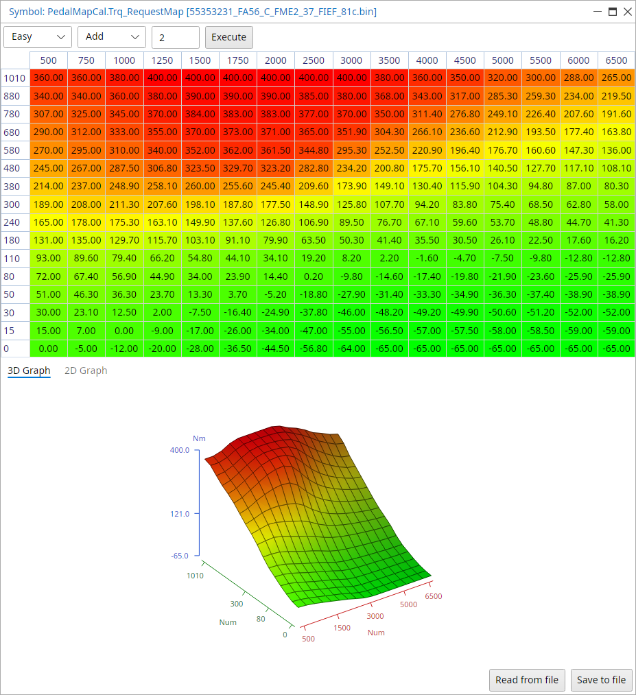{width=90%}

The table holds the requested torque in Nm for each position of the accelerator pedal and each rpm site.
Trionic now looks up the estimated engine output (torque) based on airmass and rpm.
This is done through map “TrqMastCal.Trq_NominalMap” as shown next.

<!-- TODO roffe: Dilemma's flow goes pedal → airmass → Trq_NominalMap, but Trq_RequestMap is a torque request in Nm (its description says so, and the T8 manual's airmass result viewer turns it into airmass through TrqMastCal.m_AirTorqMap). Keep his two sentences above or rewrite them? -->

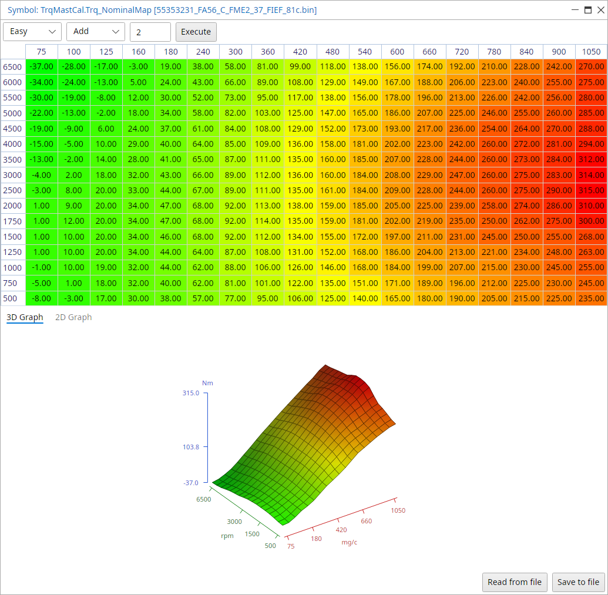{width=100%}

### Torque limiters

TrqLimCal.\*

<!-- TODO roffe: no TrqLimCal picture yet, the old one here was Trq_NominalMap (moved up). Add one to BookScreenshots, e.g. TrqLimCal.Trq_ManGear, or leave the heading without a picture? -->

### Airmass to torque calibration map

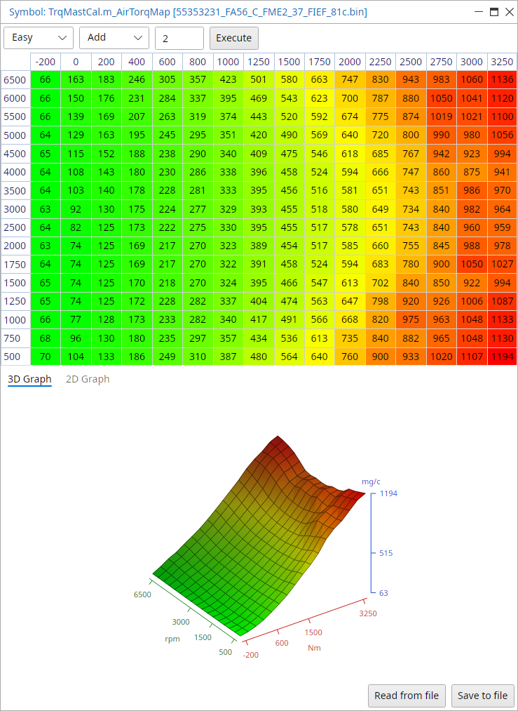{width=71%}

Maximum RPM depending on coolant temp:

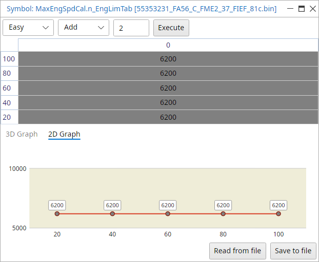{width=60%}

## Footer information {.advanced}
