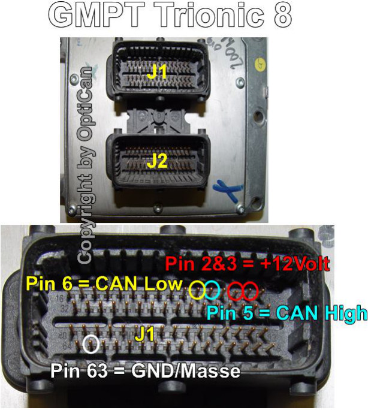
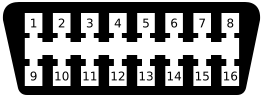

# CAN Bus interface

Interfacing with the Trionic T8 unit through the CAN bus is possible.

## General information

Chip used on Trionic side: Intel AN825257

Communication speed used: 615 kbit/s

The most frequently used interface for this is the lawicel CANUSB interface that can be found on [www.canusb.com](http://www.canusb.com).
This interface can convert CAN signals onto you USB port and vice versa.
The interface has a USB port on one side – that connects to you computer – and an male RS232 (DB9) connector on the other side.
This side connects to the CAN bus of the Trionic.
TxSuite works with more interfaces than the CANUSB, the list is under Supported interfaces in the TxSuite user manual.

The lawicel interface has the following pinout on the DB9 connector.

{width=64%}

## Connecting to CAN bus with ECU on your desk

{width=51%}

## OBDII socket pinout

The OBDII port enables you to connect to the I bus directly.

{width=44%}

| Pinnumber          | Description                                                |
|--------------------|------------------------------------------------------------|
| 1                  |                                                            |
| 2                  | J1850 Bus+                                                 |
| 3                  |                                                            |
| 4                  | Chassis Ground                                             |
| 5                  | Signal Ground                                              |
| 6                  | **CAN High (J-2284)**                                      |
| 7                  | ISO 9141-2 K Line                                          |
| 8                  |                                                            |
| 9                  |                                                            |
| 10                 | J1850 Bus-                                                 |
| 11                 | Airbag Controller (?)                                      |
| 12                 | ABS Controller (?)                                         |
| 14                 | **CAN Low (J-2284)**                                       |
| 15                 | ISO 9141-2 L Line                                          |
| 16                 | Battery Power                                              |

| I-Bus      | There components are hooked up to the I-Bus (instrumentation bus): |
|------------|--------------------------------------------------------------------|
| SID        | Saab Information Display                                           |
| ACC        | Automatic Climate Control                                          |
| RADIO      | Radion control unit                                                |
| CDC        | CD-Changer – in trunk                                              |
| PSM        | Power Seat Memory                                                  |
| STC        | Soft Top Control – for carbios                                     |
| Twice      | Theft Warning Integrated Control Electronics                       |
| DICE       | Dashboard Integrated Control Electronics                           |

| PBus           | These components are hooked up to the P-Bus (powertrain bus)                       |
|----------------|------------------------------------------------------------------------------------|
| TC/ABS         | Traction Control/ABS – in case of ABS only (without Traction Control) it is connected to MIU |
| Trionic 8      | Motormanagement for petrol engines                                                 |
| VP44-PSG16     | Motormanagement for diesel engines                                                 |
| TCM            | Transmission Control System – in autmatic geared cars (petrol only)                |

## SAAB P-bus communication

P-bus on Trionic 8 vehicles is available from the OBDII socket in the car.
It communicates with a bitrate of 500kb/s (high speed CAN), 11 bit frames.
This bus will allow us to read from and write to the ECU.
Currently, downloading and programming the flash is supported, as well as reading SRAM and live data.

Downloading the entire flash contents from the ECU results in a 1Mbyte binary file that can be opened in TxSuite.
In TxSuite that's ECU → Read ECU.

<!-- TODO roffe: Dilemma wrote "takes about 25 minutes" here, that was T8Suite in 2011. How long does ECU → Read ECU take now, with and without the Legion bootloader? -->

The protocol complies largely with KWP2000.

### Seed & Key algorithm

KWP2000 describes that certain functions in the ECU can be protected by a security algorithm: a seed and key calculation.
If we want to gain access to memory read and write functions we need to get secured access to the ECU.
For that we need to request a pseudo random number from the ECU, the seed.
We have to do some mathematical calculations on this number and send the result back to the ECU, the key.
If the seed and key values match, we will have gained security access to the ECU.
So far i’ve found three levels of security access for which i don’t yet know which allows for more functions than the others.
The numeric level identifiers are 0x01, 0xFB and 0xFD.

To get access to level 0x01 we request a seed and calculate the key with this algorithm:

```
key = LOOKUPTABLE[seed];
key ^= 0x1D27;
```

To get access to level 0xFB we request a seed and calculate the key with this algorithm:

```
key = LOOKUPTABLE[seed];
key ^= 0x1D27;

key ^= 0x8749;
key += 0x06D3;
key ^= 0xCFDF;
```

To get access to level 0xFD we request a seed and calculate the key with this algorithm:

```
key = LOOKUPTABLE[seed];
key ^= 0x1D27;
key /= 3 ;
key ^= 0x8749;
key += 0ACF;
key ^= 0x81BF;
```

In all these functions LOOKUPTABLE is a 65536 integer long array with predefined values.
TxSuite talks to the ECU through TrionicCANLib, its seed and key code is in `TrionicCANLib/SeedToKey.cs` in <https://github.com/roffe/Trionic>.
There the table lookup and the first XOR are one calculation: the 16 bit seed rotated right by 5 bits, plus 0xB988.

### Data encryption

To be able to write to SRAM and FLASH we need to encrypt the data we send to the ECU.
This encryption is relatively simple.
The encryption is a rotating XOR mechanism:

```
XOR 0x39
XOR 0x68
XOR 0x77
XOR 0x6D
XOR 0x47
XOR 0x39
```

So, six XOR values, which are used one after the other.
First byte goes XOR 0x39, second byte XOR 0x68 etc...
