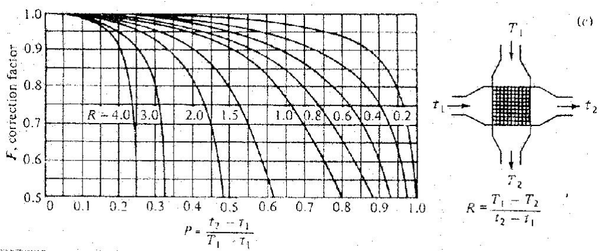

# Appendix XVI: Intercooler calculation

## Description

This appendix will explain how to do calculations on intercooler flow capacity.
A larger than stock intercooler is needed of you plan to go over 300 bhp with a Trionic 5 engine.

An intercooler is a [heat exchanger]{.underline}.
That means there are two or more fluids or gases that don't physically touch each other but a transfer heat or energy takes place between them.
At wide open throttle and full boost the hot compressed air coming from a turbocharger is probably between 250 and 350 ˚F depending on the particular turbo, boost pressure, outside air temperature, etc..
We want to cool it down, which reduces its volume so we can pack more air molecules into the cylinders and reduce the engine's likelihood of detonation.

How does an intercooler work?
Hot air from the turbo flows through tubes inside the intercooler.
The turbo air transfers heat to the tubes, warming the tubes and cooling the turbo air.
Outside air (or water in a watercooler intercooler) passes over the tubes and between fins that are attached to the tubes.
Heat is transferred from the hot tubes and fins to the cool outside air.
This heats the outside air while cooling the tubes.
This is how the turbo air is cooled down.
Heat goes from the turbo air to the tubes to the outside air.

There are some useful equations which will help us understand the factors involved in transfering heat.
After we look at these equations and see what's important and what's not, we can talk about what all this means.

### Equation 1

The first equation describes the overall heat transfer that occurs.

$$
Q = U \times A \times \text{DTlm}
$$

**Q** is the amount of energy that is transferred.

**U** is called the heat transfer coefficient.
It is a measure of how well the exchanger transfers heat.
The bigger the number, the better the transfer.

**A** is the heat transfer area, or the surface area of the intercooler tubes and fins that is exposed to the outside air.

**DTlm** is called the log mean temperature difference.
It is an indication of the "driving force", or the overall average difference in temperature between the hot and cold fluids.
The equation for this is:

$$
\text{DTlm} = \frac{(\text{DT1}-\text{DT2}) * F}{\ln(\text{DT1}/\text{DT2})}
$$

where **DT1** = turbo air temperature in - outside air temperature out\
**DT2** = turbo air temperature out - outside air temperature in\
**F** = a correction factor, see below

***Note:***

The outside air that passes through the fins on the passenger side of the intercooler comes out hotter than the air passing through the fins on the drivers side of the intercooler.
If you captured the air passing through all the fins and mixed it up, the temperature of this mix is the "outside air temperature out".

F is a correction factor that accounts for the fact that the cooling air coming out of the back of the intercooler is cooler on one side than the other.

To calculate this correction factor, calculate "P" and "R":

$$
P = \frac{\text{turbo air temp out} - \text{turbo air temp in}}{\text{outside air temp in} - \text{turbo air temp in}}
$$

$$
R = \frac{\text{outside air temp in} - \text{outside air temp out}}{\text{turbo air temp out} - \text{turbo air temp in}}
$$

Find P and R on "Fchart.jpg" (below) and read F off the left hand side.

{width=93%}

This overall heat transfer equation shows us how to get better intercooler performance.
To get colder air out of the intercooler we need to transfer more heat, or make Q bigger in other words.
To make Q bigger we have to make U, A, or DTlm bigger, so that when you multiply them all together you get a bigger number.
More on that later.

### Equation 2

We also have an equation for checking the amount of heat lost or gained by the gas (or fluid) on one side of the heat exchanger (ie, just the turbo air or just the outside air):

$$
Q = m \times \text{Cp} \times \text{DT}
$$

**Q** is the energy transferred.
It will have the exact same value as the Q in the first equation.
If 5000 BTU are transferred from turbo air to outside air, then Q = 5000 for this equation AND the first equation.

**m** is the mass flowrate (lbs/minute) of fluid, in this case either turbo air or outside air depending on which side you're looking at.

**Cp** is the heat capacity of the air.
This is a measure of the amount of energy that the fluid will absorb for every degree of temperature that it goes up.
It is about 0.25 for air and 1.0 for water.
Air doesn't do a great job of absorbing heat.
If you put 10 BTU into a pound of air the temperature of it goes up about 40 degrees.
If you put 10 BTU into a pound of water, the temperature only goes up about 10 degrees!
Water is a great energy absorber.
That's why we use water for radiators instead of some other fluid.

**DT** is the difference in temperature between the inlet and outlet.
If the air is 200 deg going in and 125 deg coming out, then DT = 200 - 125 = 75.
Again, on the cooling air side the outlet temperature is the average "mix" temperature.

If you know 3 of the 4 main variables on one side of the exchanger (the amount of heat transferred, the inlet and outlet temperatures, and the fluidís flow rate) then this equation is used to figure out the 4th.
For example, if you know the amount of heat transferred, the inlet temperature, and the flow rate you can calculate the outlet temperature.
Since you canít measure everything, this equation is used to figure out what you donít know.

**Caveat:**

These equations are all for steady state heat transfer, which we probably don't really see too much under the conditions that we are most interested in – turbocharged engines!
Cruising on the highway you would definitely see steady state.

So, now that we've got these equations, what do they **REALLY** tell us?

1. Heat transfer goes really well when there is a large temperature difference, or driving force, between the two gases.
   This is shown in equation 1 as a large DTlm.
   It doesn't go as well when there is a small temperature difference between the two gases (small DTlm).
   The closer you get the intercooler outlet temperature to the outside air temperature the smaller DTlm gets, which makes the heat transfer tougher.

2. The difference between the intercooler outlet temperature and the outside air temperature is called the [approach]{.underline}.
   If it is 100 degrees outside and your intercooler cools the air going into the intake manifold down to 140 degrees, then you have an approach of 40 degrees (140 - 100 = 40).
   To get a better (smaller) approach you have to have more area or a better U, but there is a problem with diminshing returns.
   Lets rearrange the first equation to Q/DTlm = U x A.
   Every time DTlm goes down (get a better temperature approach) then Q goes up (transfer more heat, get a colder outlet temperature), and dividing Q by DTlm gets bigger a lot faster than U x A does.
   The upshot of that is we have a situation of diminishing returns; for every degree of a better approach you need more and more U x A to get there.
   Start with a 30 deg approach and go to 20 and you have to improve U x A by some amount, to go from 20 to 10 you need to increase U x A by an even bigger amount.

3. I would consider an approach of 20 degrees to be pretty good.
   In industrial heat exchangers it starts to get uneconomical to do better somewhere around there, the exchanger starts to get too big to justify the added expense.
   The one time I checked my car (stock turbo, stock IC, ported heads, bigger cam) I had an approach of about 60 deg.
   The only practical way of making the DTlm bigger on an existing intercooler is to only drive on cold days; if you buy a better intercooler you naturally get a better DTlm.

4. You can transfer more heat (and have cooler outlet temps) with more heat transfer area.
   That means buying a new intercooler with more tubes, more fins, longer tubes, or all three.
   This is what most aftermarket intercoolers strive for.
   Big front mounts, intercooler and a half, etc... are all increasing the area.

   A practical consideration is the fin count.
   The area of the fins is included in the heat transfer area; more fins means more area.
   If you try to pack too many fins into the intercooler the heat transfer area does go up, which is good, but the cooling air flow over the fins goes down, which is bad.
   Looking at the 2^nd^ equation, Q = m \* Cp \* DT, when the fin count is too high then the air flow ("m") drops.
   For a given Q that you are trying to reach then you have to have a bigger DT, which means you have to heat up that air more.
   Then THAT affects the DTlm in the first equation, making it smaller, and lowering the overall heat transfer.
   So there is an optimum to be found.
   Starting off with bare tubes you add fins and the heat transfer goes up because you're increasing the area, and you keep adding fins until the it starts to choke off the cooling air flow and heat transfer starts going back down.
   At that point you have to add more tubes or make them longer to get more heat transfer out of the increased area.

5. Make U go up.
   You can increase the U by adding or improving "turbulators" inside the tubes.
   These are fins inside the tubes which cause the air to swirl inside the tube and makes it transfer its heat to the tube more efficiently.
   Our intercoolers have these, but I understand that more efficient designs are now available.
   One of the best ways to increase the U is to clean the tubes out!
   Oil film (from a bad turbo seal or from the stock valve cover breather) inside the tubes acts as an insulator or thermal barrier.
   It keeps heat from moving from the air to the tube wall.
   This is expressed in our equation as a lower U.
   Lower U means lower Qs which mean hotter turbo air temperatures coming out of the intercooler.

6. Air-to-water.
   If we use water as the cooling medium instead of outside air, we can see a big improvement for several reasons: Water can absorb more energy with a lower temperature rise.
   This improves our DTlm, makes it bigger, which makes Q go up and outlet temps go down.
   A well designed water cooled exchanger also has a much bigger U, which also helps Q go up.
   And since both DTlm and U went up, you can make the area A smaller which makes it easier to fit the intercooler in the engine compartment.
   Of course, there are some practical drawbacks.
   The need for a water circulation system is one.
   A big one is cooling the water down after it is heated (which means another radiator).
   This leads to another problem: You heat the water, and cool it down with outside air like the Syclone/Typhoon.
   You can't get it as cool as the outside air, but maybe you can get it within 20 degrees of it.
   Now you are cooling the turbo air with water that is 20 hotter than the outside air, and you can only get within 15 degrees of that temperature so coming out of the intercooler you have turbo air that is 35 degrees hotter than outside!
   (turbo air is 15 deg over water temp which is 20 deg over outside temp).
   You could have easily done that with an air to air intercooler!
   But... if you put ice water in your holding tank and circulate that... Then maybe the air temp coming out of the intercooler is 15 deg above that or 45 to 50 deg.
   Hang on!
   But after the water warms up, you're back to the hot air again.
   So, great for racing, not as good for the street.

7. Lower the inlet temperature.
   The less hard the turbo has to work to compress the air then the lower the temperature the air coming out of the turbo is.
   This actually hurts the DTlm, but still if it's cooler going in it will be cooler coming out.
   You can work the turbo less hard by running less boost, by improving the pressure drop between the air filter and the turbo, or by having a more efficient compressor wheel.
   You can also reduce the pressure drop in the intercooler, which allows you to run the same amount of boost in the intake manifold while having a lower turbo discharge pressure.
   More on this later.
   If you can drop the turbo outlet pressure by 2 psi, or raise the turbo inlet pressure by 1 psi, that will drop the turbo discharge temperature about 16 degrees (depending on the compression efficiency and boost level).
   If the turbo air is going into the intercooler 16 degrees colder then it may come out only 10 degrees colder than before, but that is still better than what it was.

## Pressure drop

Another aspect of intercoolers to be considered is pressure drop.
The pressure read by a boost gauge is the pressure in the intake manifold.
It is not the same as the pressure that the turbocharger itself puts out.
To get a fluid, such as air, to flow there must be a difference in pressure from one end to the other.
Consider a straw that is sitting on the table.
It doesn't having anything moving through it until you pick it up, stick it in your mouth, and change the pressure at one end (either by blowing or sucking).
In the same way the turbo outlet pressure is higher than the intake manifold pressure, and will always be higher than the intake pressure, because there must be a pressure difference for the air to move.

The difference in pressure required for a given amount of air to move from turbo to intake manifold is an indication of the hydraulic restriction of the intercooler, the up pipe, and the throttle body.
Let's say you are trying to move 255 gram/sec of air through a stock intercooler, up pipe, and throttle body and there is a 4 psi difference that is pushing it along.
If your boost gauge reads 15 psi, that means the turbo is actually putting up 19 psi.
Now we increase the amount of air travelling though to 450 gram/sec of air.
At 15 psi boost in the intake manifold the turbo now has to put up 23 psi, because the pressure drop required to get the higher air flow is now 8 psi instead of the 4 that we had before.
More flow with the same equipment means higher pressure drop.
So we put on a new front mount intercooler.
It has a lower pressure drop, pressure drop is now 4 psi, so the turbo is putting up 19 psi again.
Now we add the larger throttle body and the pressure drop is now 3 psi.
Then we add the 3" up pipe, and it drops to 2.5 psi.
Now to make 15 psi boost the turbo only has to put up 17.5 psi.
The difference in turbo outlet temperature between 23 psi and 17.5 psi is about 40 deg (assuming a constant efficiency)!
So you can see how just by reducing the pressure drop we can lower the temperatures while still running the same amount of boost.

Pressure drop is important because the higher the turbo charging pressure is, the higher the temperature of the turbo air.
When we drop the turbo charging pressure we also drop the temperature of the air coming out of the turbo.
When we do that we also drop the intercooler outlet temperature, although not as much, but every little bit helps.
This lower pressure drop is part of the benefit offered by new, bigger front mount intercoolers; by bigger up pipes; and by bigger throttle bodies.
You can also make the turbo work less hard by improving the inlet side to it.
K&N air filters, these all reduce the pressure drop in the turbo inlet system which makes the compressor work less to produce the same boost which will reduce the turbo charge temperature.
