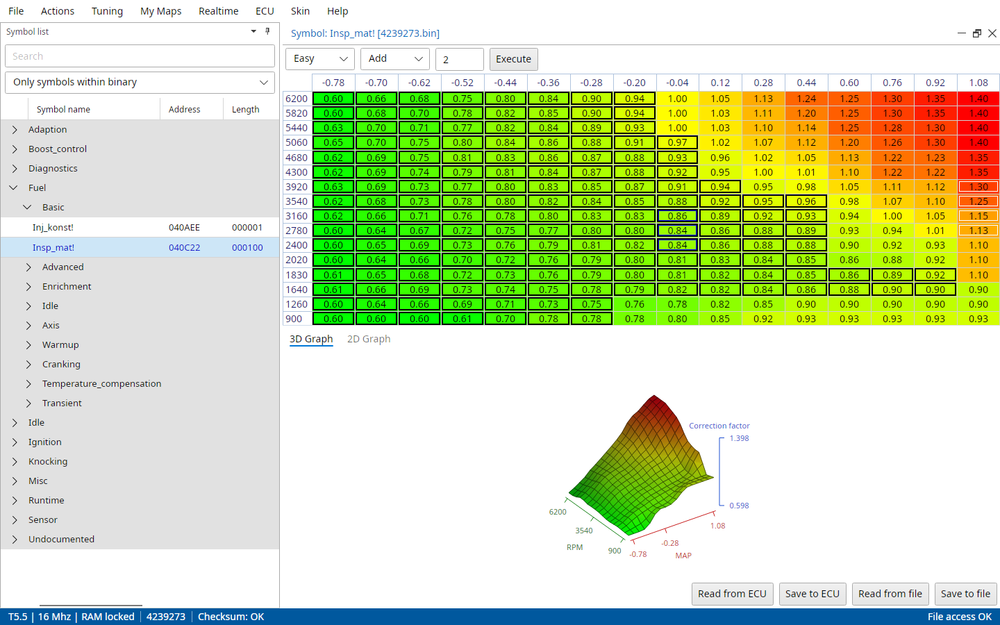
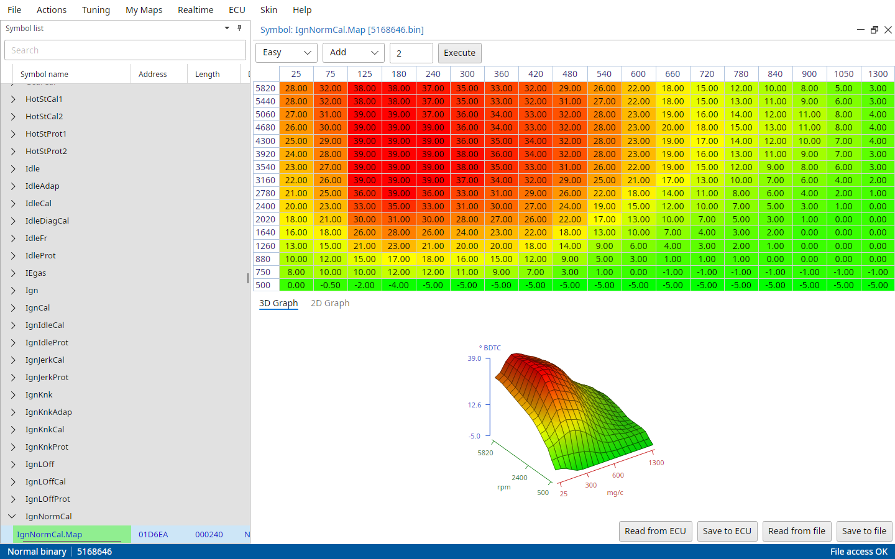
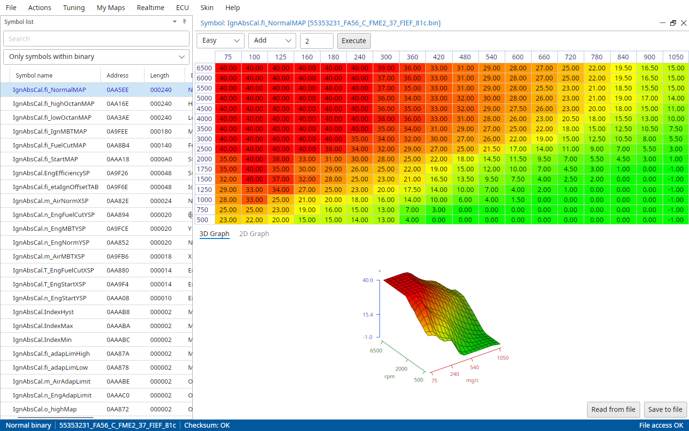
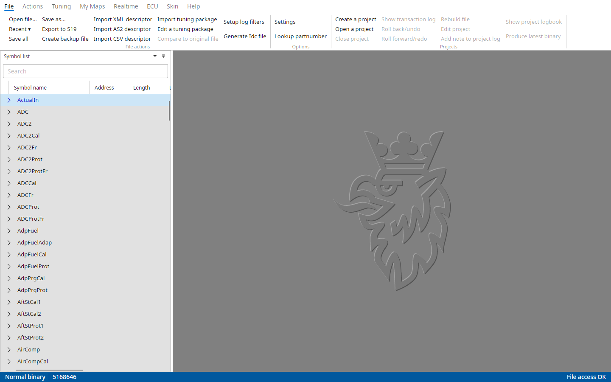
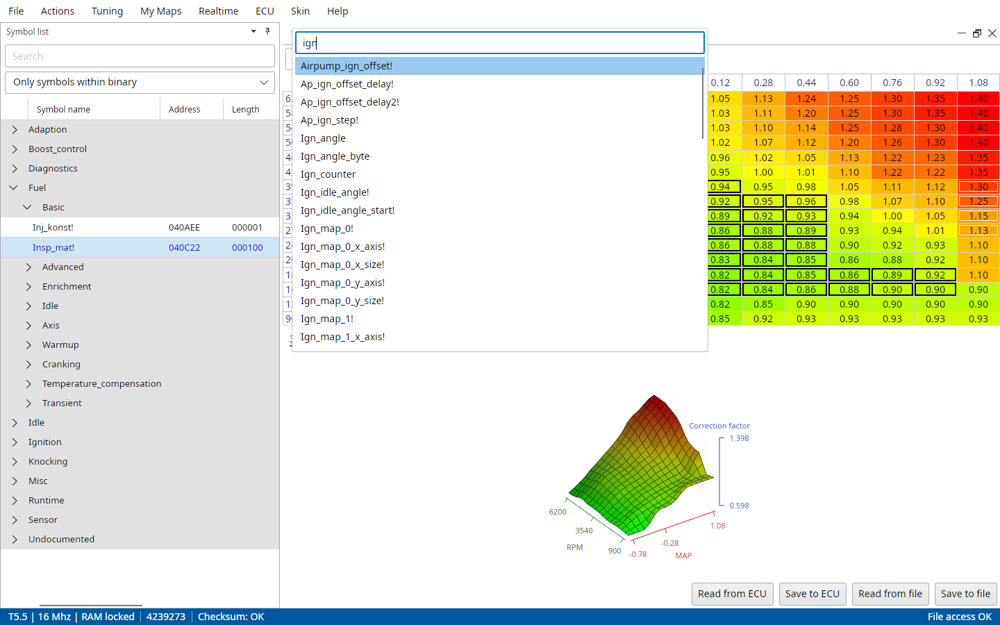
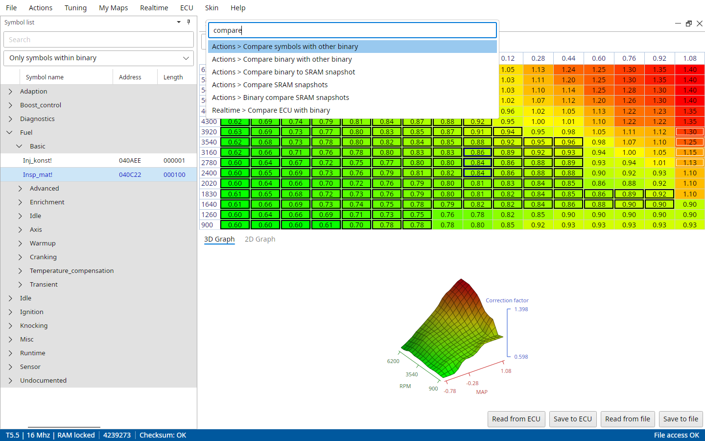
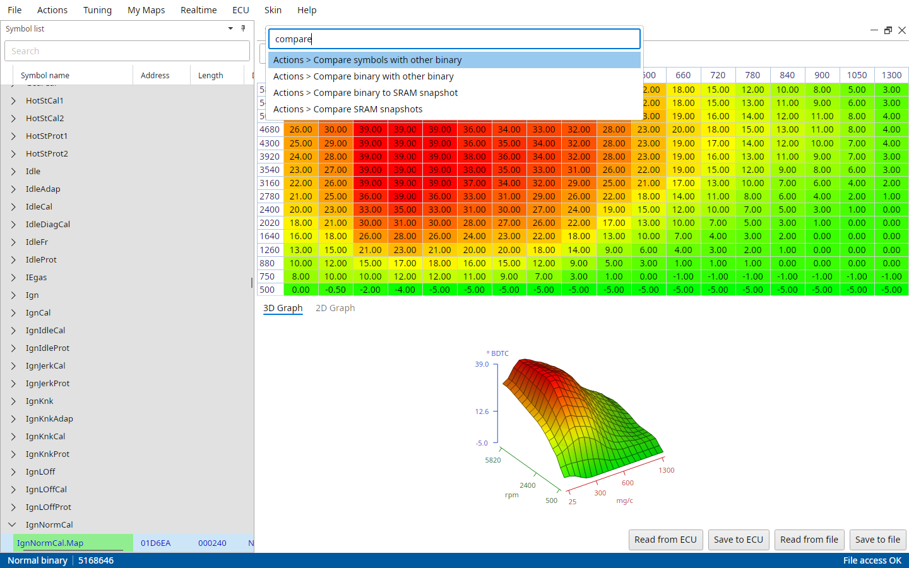
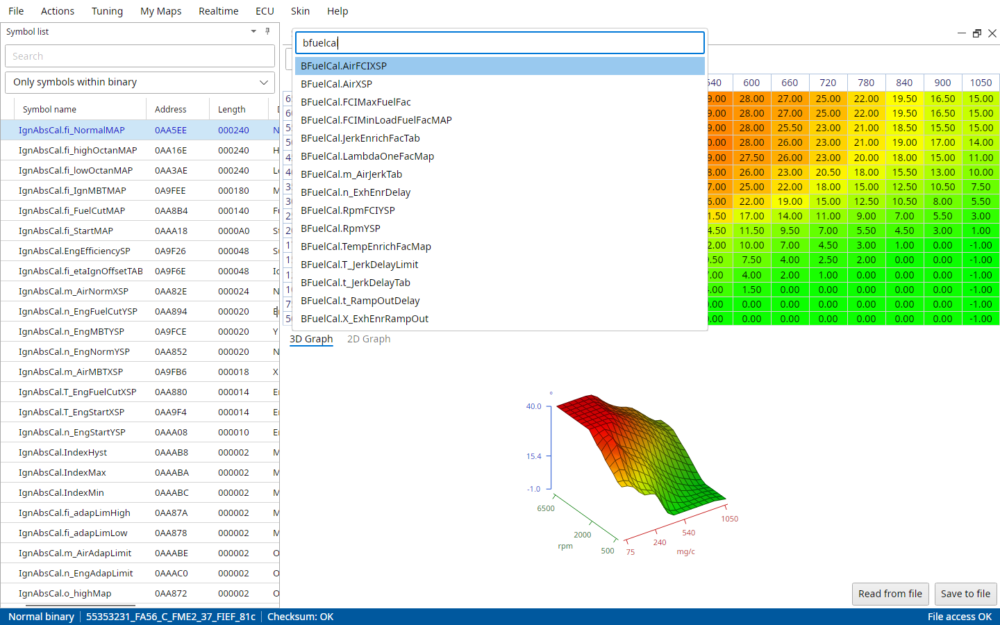
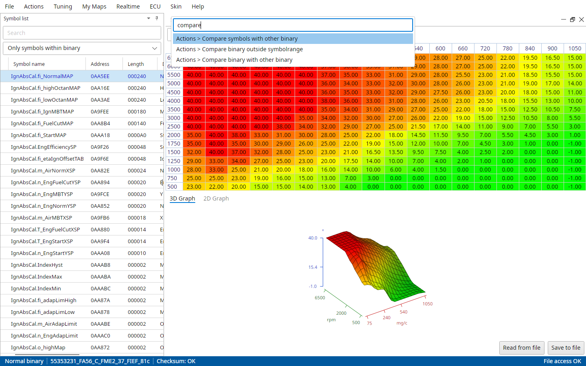

# The main window

TxSuite is controlled by the menu and the symbol list shown on the left hand side of the screen.
Maps, compare results, the realtime panel and the other tools open as windows in the workspace on the right.
The status bar at the bottom shows what is open and how it's doing.

::: {.content-visible when-profile="t5-manual"}
{#fig-main-window-t5 width=100%}
:::

::: {.content-visible when-profile="t7-manual"}
{#fig-main-window-t7 width=100%}
:::

::: {.content-visible when-profile="t8-manual"}
{#fig-main-window-t8 width=100%}
:::

## The menu

The menus are File, Actions, Tuning, My Maps, Realtime, ECU, Skin and Help.
What every ECU has is always there.
An ECU's own items only show while a file of that ECU is open, in the place they had in that ECU's old suite.
With no file open only the shared items show.

Items that need an open file are greyed out until you open one.
The ECU follows the file as well: Connect ECU, Read ECU and the other ECU actions need a file of that ECU open, because the file tells TxSuite which ECU it is talking to.
Without one TxSuite says "A file must be loaded first: it tells which ECU (Trionic 5, 7 or 8) to connect to."

The menus are described one by one in the chapters after this one.

## The ribbon bar

The old suites had a ribbon bar instead of menus.
File → Settings → Common → Show ribbon bar instead of menus brings it back, at once.

{#fig-ribbon-t7 width=100%}

The ribbon is made from the menus, so it always has the same items.
Each menu is a tab, each section of a menu a group with its items as buttons.
Groups that don't fit in the window fold into a button that drops them down.

- Double-click a group's caption to fold it, double-click a folded one to keep it open.
- Drag a group by its caption to put it somewhere else on its tab.
- Right-click a caption and pick Reset this tab's groups to get the menu's order back.

The folds and order are remembered per ECU and per tab.
The buttons have text only, no icons, and there is no Exit button: close the window.

## Opening a file

File → Open file... opens a binary or a Motorola S19 file.
TxSuite looks at the file and picks the ECU by it: T5 and T7 by size and content, T8 by its 1 MB size.

A file opens from these places too:

- File → Recent, the files opened before.
- A file dropped on the main window.
- Open with in the file manager, or the file name on the command line.
- Opening a project, or Lookup partnumber's Open this file and Create new from original.
- File → Settings → Common → Auto load last file on startup reopens the last file (or project) when TxSuite starts.

Opening a file of another ECU closes everything of the one before, as when the suites were separate programs.
Maps with unsaved changes are asked about first, Cancel keeps it all.
Nothing switches while an ECU is being flashed or a T5 autotune runs.
A file no ECU takes gives "File is not a Trionic 5, 7 or 8 binary file!".

After opening, the symbol list on the left is filled with the symbols of the file, see the next chapter.

## Dropping files

Files dropped on the main window load like they do from the menu:

- a binary opens as with File → Open file,
- an SRAM dump loads as with Actions → Import SRAM snapshot,
- a logfile of the open file's ECU opens as with Realtime → Load logfile.

Everything else (tuning packages, descriptors, CSV files, reports) stays with its menu item, so nothing changes the binary by accident.
A file dropped on a hex view opens in that hex view.

## Windows in the workspace

Maps, compare results, the hex view, the realtime panel and the other tools open as windows inside the workspace.
Move them by their title bar, resize them by their edges, and minimize, maximize or close them with the buttons on the right of the title bar.
A double-click on the title bar maximizes a window too.

Drag a window's title bar out of the main window and it floats in a window of its own, handy with a second screen.
Its "Dock back into main window" button brings it back.

The Skin menu has the window layout: Cascade windows, Tile windows horizontally, Tile windows vertically and Dock all floating windows.

When a compare shows a map of two files, both share one window with a tab per file.

## The status bar

The status bar shows, from left to right:

- "Open/dev binary" for open (development) software, else "Normal binary",
- the file name[\ and "Checksum: OK" or what is wrong with it]{.content-hidden when-profile="t7-manual"},
- the SRAM snapshot that is loaded, if any,
- the connection to the ECU,
- the result of the update check.

::: {.content-visible when-profile="t5-manual"}
On a T5 it starts with the ECU type, CPU speed and RAM lock of the file instead, as in "T5.5 | 16 Mhz | RAM locked".
:::

::: {.content-visible when-profile="t7-manual"}
On a T7 the checksum isn't shown there, Actions → Verify checksum tells you.
:::

The right side shows the progress of what is running (reading, flashing, extracting) and whether the file can be written, "File access OK".

## Symbol palette and command palette

Like in VS Code, Ctrl+P opens a symbol by any part of its name and Ctrl+Shift+P runs any menu command (Cmd on macOS).
Type a part of what you are looking for, move with the arrow keys, Enter or a click picks, Escape closes.

::: {.content-visible when-profile="t5-manual"}
{#fig-palette-symbols-t5 width=100%}

{#fig-palette-commands-t5 width=100%}
:::

::: {.content-visible when-profile="t7-manual"}
{#fig-palette-symbols-t7 width=100%}

{#fig-palette-commands-t7 width=100%}
:::

::: {.content-visible when-profile="t8-manual"}
{#fig-palette-symbols-t8 width=100%}

{#fig-palette-commands-t8 width=100%}
:::

The symbol palette lists the symbols of the open file that a double-click in the symbol list would open.
The command palette lists every menu command that is available right now as "Menu > Item", the Recent files and the map entries of the Tuning and My Maps menus included.

## Keyboard shortcuts

| Key | What it does |
|---|---|
| Ctrl+P | Open a symbol by name |
| Ctrl+Shift+P | Run a menu command |
| Shift+F1 | Realtime → Toggle realtime panel |
| F6 | Realtime → Write log marker |
| Enter | Open the selected symbol in the symbol list |

::: {.content-visible when-profile="t5-manual"}
Shift+F5 is Realtime → Toggle Autotune, with File → Settings → T5 → Advanced mode enabled.
:::

The map viewer has its own keys, see Working with maps.
