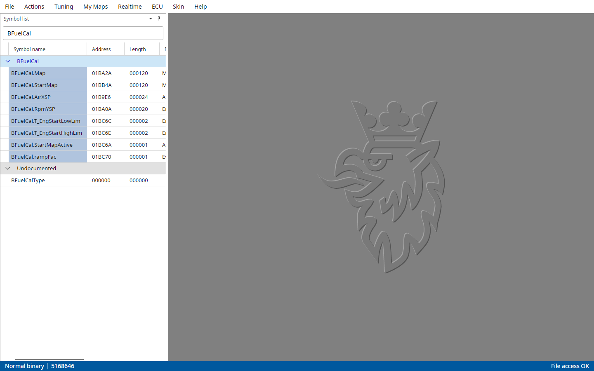
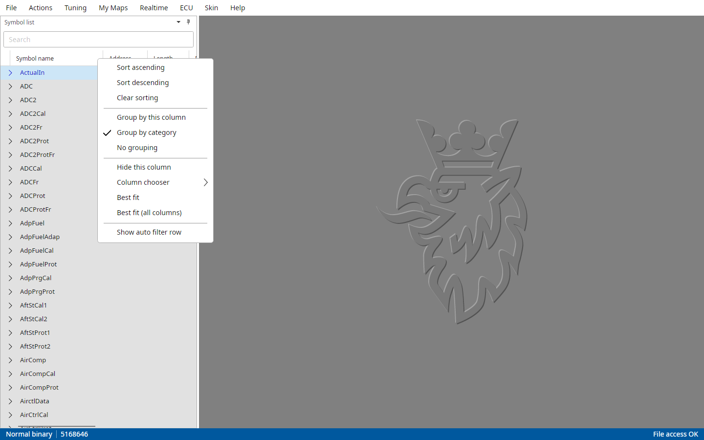
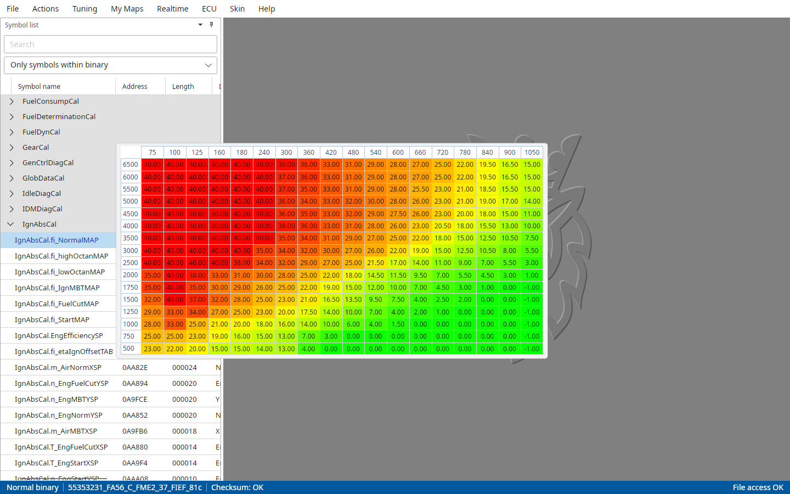

# The symbol list

After a file is opened the symbol list on the left hand side of the main window is filled with its symbols.
The symbols are grouped by category and every category starts folded, click the arrow in front of one to open it.
The Left arrow key folds the category of the selected symbol again.

::: {.content-visible when-profile="t5-manual"}
TxSuite reads the symbol table from the file.
A T5 binary always has one, so there is nothing to extract or import.
:::

::: {.content-visible when-profile="t7-manual"}
TxSuite extracts the symbol table from the file automatically when it opens it.
For stripped EU0AF01C and EU09F01C binaries TxSuite offers to load the symbol list it knows for that software.
Binaries without a symbol table can be described with an XML, AS2 or CSV descriptor, see the File menu.
:::

::: {.content-visible when-profile="t8-manual"}
TxSuite reads the symbol table from the file, packed or encrypted, and checks the checksum while it's at it.
Binaries without a symbol table can be described with an XML, AS2 or CSV descriptor, see the File menu.
With File → Settings → T8 → Auto mapdetection active TxSuite tries to name the symbols of such a file by itself.
:::

The columns are Symbol name, Address, Length, Description and User description.
More are hidden, like Number, SRAM address and Category, the column chooser shows them (see Sorting and grouping below).
Addresses and lengths are hexadecimal or decimal by File → Settings → Common → Show addresses and lengths in Hex.

The User description column is yours: click a cell to type a note for that symbol.
It is saved next to the bin in `<bin>.xml`.

With File → Settings → Common → Show descriptions under symbol names each symbol's description shows on a line of its own under its name, as the old T7Suite and T8Suite did.
File → Settings → Common → Symbol list font size makes the list's text larger or smaller.

## Selecting symbols

Choose a symbol by double-clicking it or by selecting it and pressing Enter.
A new window opens in the workspace with the map of that symbol, titled "Symbol: \<name\> [\<file\>]".
Opening a map that is open already brings its window to the front.
Working with that window is the next chapter.

It also works the other way around: the map in front is selected in the symbol list, with its category opened.

Ctrl+P is the quick way, type any part of a symbol's name and Enter opens it.

## Searching

Type in the Search box above the list and it shows only the symbols with that text in their name, description, user description, address or length.
The categories open so the matches show.
Clear the box and the categories fold again, except the one of the selected symbol.

{#fig-symbol-search width=100%}

## Filtering

::: {.content-visible when-profile="t5-manual"}
Below the Search box is a filter.
By default it shows "Only symbols within binary", the symbols that are actually stored in the flash.
Choose "All symbols" to see the symbols that only live in SRAM too.
TxSuite switches to all symbols by itself when you connect to the ECU or load an SRAM snapshot.
:::

::: {.content-visible when-profile="t8-manual"}
Below the Search box is a filter.
By default it shows "Only symbols within binary", the symbols that are actually stored in the flash.
"All symbols" shows the symbols that only live in SRAM too, and "Only live-tuneable symbols" only the ones you can change in the running ECU.
:::

Right-click a column header and choose Show auto filter row for a filter box per column.
Text typed in one shows only the symbols with that text in that column, and several boxes work together.

## Sorting and grouping

Click a column header to sort on that column, click it again to sort the other way around.
The categories stay in their order, the symbols are sorted within them.

Right-click a column header for more:

- Sort ascending, Sort descending and Clear sorting.
- Group by this column, Group by category (the default) and No grouping.
- Hide this column, and the Column chooser to show or hide any column.
- Best fit and Best fit (all columns) to size the columns to their content.
- Show auto filter row, see Filtering.

Columns can be dragged to another place and resized by their edges.

{#fig-symbol-list-header-menu-t7 width=100%}

## Map preview popup

Point at a symbol's name and its map pops up as a read-only table next to it.
File → Settings → Common → Show map preview popup turns it off and on.

{#fig-map-preview width=100%}

## The symbol menu

Right-click a symbol for these:

Add to realtime list
:   Adds the symbol to the realtime panel's free logging list.

Add to MyMaps
:   Adds the symbol to your own My Maps menu.

Read from SRAM file
:   Opens the symbol's map from the SRAM snapshot that is loaded with Actions → Import SRAM snapshot.

Browse axis information
:   Shows the symbol in Actions → Browse axis information.

Export symbollist as CSV
:   Saves the whole symbol list as a CSV file.

::: {.content-visible when-profile="t5-manual"}
Add to realtime user maps
:   Adds the map to the User maps tab of the realtime panel.
:::

::: {.content-visible when-profile="t7-manual"}
Read symbol from ECU
:   Reads the symbol's map from the connected ECU.
:::

::: {.content-hidden when-profile="t5-manual"}
Export as tuning package
:   Saves the selected symbols as a tuning package.

Export fixed tuning package
:   Saves a tuning package with the maps a stage tune touches.

Edit a tuning package
:   Opens the tuning package editor, as File → Edit a tuning package.
    Its Add selected symbols button takes the symbols selected here.
:::

## Hiding the symbol list

File → Settings → Common → Hide symbol window hides the symbol list to a tab at the side of the window.
The tab brings the list out again, and it slides away when you open a map.
The pin button at the top of the list does the same.
