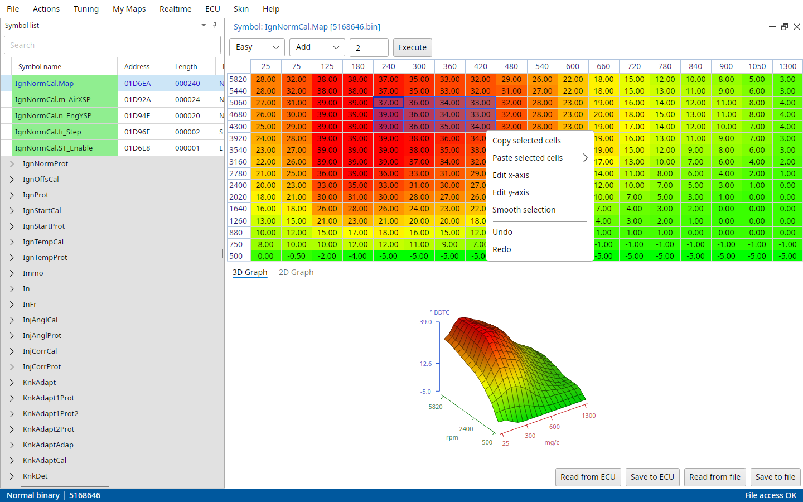

# Working with maps

A symbol opened from the symbol list shows in a map viewer, a window in the workspace with the table on top and its graphs below.
You can see one in the picture at the start of The main window chapter.

From top to bottom the map viewer has:

- the toolbar: the view type, and the math on the selection (operation, value and Execute),
- the table, with the x axis above it and the y axis on its left,
- the graphs, a 3D Graph tab and a 2D Graph tab,
- the buttons Read from ECU, Save to ECU, Read from file and Save to file.

The splitter between the table and the graphs moves up and down.
File → Settings → Common → Show graphs in mapviewer turns the graphs off, for slower computers.
Read from ECU and Save to ECU only show for symbols the ECU has in its RAM.

## Hexadecimal mode

The view type box in the toolbar switches the table between Hex, Decimal, Easy and ASCII.

Hex
:   The raw values in hexadecimal.

Decimal
:   The raw values in decimal, as the ECU stores them.

Easy
:   The values converted with the map's factor and offset to what they mean, degrees, bar, mg/c and so on.
    Easy view is best if you don't know what this means ;)

ASCII
:   The bytes as text, read only.

The view type a map opens in is set by File → Settings → Common → Default view type for maps.
Each map viewer can still be switched to another view type.

## Color indicators

All maps are displayed in colours from green (low values) through yellow to red (high values), over the smallest and largest value of that map.
If you find this hard to tell apart, File → Settings → Common → Color blind mode has other colour scales: Universal, Protanopia, Tritanopia and Deuteranomaly.
They are used for the table, both graphs and the airmass result viewer, open map viewers change at once.

Maps opened from the ECU while connected keep their own colours, so you can see they show what's live in the ECU.

File → Settings → Common → Mapviewer cell spacing puts space between the cells, 0 to 20 pixels.
With a space the cells show as separate tiles without the lines between them.

::: {.content-visible when-profile="t5-manual"}
Some T5 maps have marks in their cells:

- a black rectangle around the cells that operate in closed loop (Insp_mat!, Ign_map_0!, Fuel_knock_mat!),
- a padlock on cells below the knock pressure limit and on cells locked by autotune,
- a blue rectangle for the knock adaption range and a white one for the boost adaption range,
- a rectangle on the cells of the AFR feedback maps that have measurements.
:::

::: {.content-visible when-profile="t7-manual"}
Maps over airmass and rpm can mark the cells in the closed loop area, with a black square around the cell or a green triangle in its corner.
File → Settings → T7 → Closed loop indicator picks which, or none.
:::

## Selecting cells

Click a cell to select it, drag to select a block.
Shift+click extends the selection, Ctrl+click adds or removes cells.
The arrow keys move the selection, Ctrl+A selects the whole map.

## Adjusting values in a map

To avoid that you have to adjust all values of a "large" map manually some features have been added to the map editor:

| Key | What it does to the selected cells |
|---|---|
| Plus | adds 1 |
| Minus | subtracts 1 |
| PageUp | adds 10 (0x10 in hex view) |
| PageDown | subtracts 10 (0x10 in hex view) |
| Home | sets them to the maximum value |
| End | sets them to 0 |

Typing a value starts editing, F2 edits the focused cell starting from its value, Enter stores it and Esc throws it away.
With several cells selected the typed value goes into all of them.

The toolbar does math on the selection: pick Add, Multiply, Divide or Fill, type the value and click Execute.

Ctrl+Z undoes the last change and Ctrl+Y redoes it, as many steps back as you like.
Undo and Redo are in the table's right-click menu too.

## Copy and paste

To be able to get your work done faster you can select one or more cells in a table and copy them to the clipboard by right-clicking and selecting "Copy selected cells".
With nothing selected the whole map is copied.

To paste the cells select the location where you want the cells to appear (this could be in another map and even in another binary), right-click and select "Paste selected cells" and then "At original position" or "At currently selected location".

Copy selected cells uses TxSuite's own format, for pasting into maps.
Ctrl+C copies the selected cells as plain text with tabs, that pastes straight into a spreadsheet.

## Smoothing

Select a row, a column or a block and pick Smooth selection in the table's right-click menu.
A row or column becomes a straight line between its first and last value, a block gets the average of its neighbours in each cell inside it, the cells on its edge stay as they are.

## Editing the axes

Edit x-axis and Edit y-axis in the table's right-click menu open the axis as a map of its own, to change its values.

{#fig-mapviewer-menu-t7 width=100%}

## Graphs

The 3D Graph tab shows the map as a surface.
Drag with the left mouse button to turn it, with the right button to roll it and with the middle button to move it, and the mouse wheel zooms.

The 2D Graph tab shows one column of the map as a line over the y axis, the slider below it picks which column.

With File → Settings → Common → Synchronize mapviewers on, viewers of the same map follow each other: selecting cells in one selects them in the others, and turning one graph turns the others.

## Saving changes

Save to file writes the map into the binary and updates the checksum.
Read from file throws away the changes and reads the map from the file again.

Closing a viewer with changes asks "Data was mutated, do you want to save these changes in you binary?", Yes saves, No throws the changes away and Cancel keeps the viewer open.
Closing TxSuite asks the same for each changed viewer.
File → Save all saves every open viewer at once.

In a project every save is a transaction in the project's log, see the Projects chapter.

## Maps from the ECU

When the ECU is connected, Read from ECU reads the map from the ECU's RAM and Save to ECU writes it there, every viewer of that map follows.
When the ECU refuses a write TxSuite says so.

::: {.content-visible when-profile="t5-manual"}
On a T5 every map opens with the ECU's SRAM data while connected, and Save writes the ECU and the file in one go.
The ECU only takes changes with RAM unlocked, see RAM locked in the Firmware information chapter.
A map that only lives in SRAM opens from the loaded SRAM snapshot when you're offline, otherwise TxSuite says "Symbol resides in SRAM and you are in offline mode...".
:::

::: {.content-visible when-profile="t7-manual"}
Only open (development) software takes changes in the running ECU.
:::

::: {.content-hidden when-profile="t5-manual"}
Maps that only live in the ECU's RAM are read from the ECU when you open them.
Offline they open from the SRAM snapshot loaded with Actions → Import SRAM snapshot.
:::

File → Settings → Common → Auto update SRAM viewers every … seconds reads these maps from the ECU again and again while connected.
This enables you to keep an eye on for example the knock map.
Viewers with unsaved changes are left alone.
Don't set the interval too short, it takes time from the realtime panel.

## Checksum

For you to be able to use the binary after altering maps or other information within it, the checksum must be updated after alteration of data.
TxSuite does that every time it writes a map into the binary.

File → Settings → Common → Auto update checksum makes sure the checksum is right everywhere else too.
Advised is to keep this turned on!
With it off TxSuite asks before it corrects a wrong checksum, and before it flashes a file with one.

Actions → Verify checksum checks the open file's checksum by hand.

::: {.content-visible when-profile="t8-manual"}
On a T8 the checksum is checked every time a file opens, the status bar shows "Checksum: OK".
With Auto update checksum on a wrong one is corrected without asking, otherwise TxSuite asks per layer.
:::
