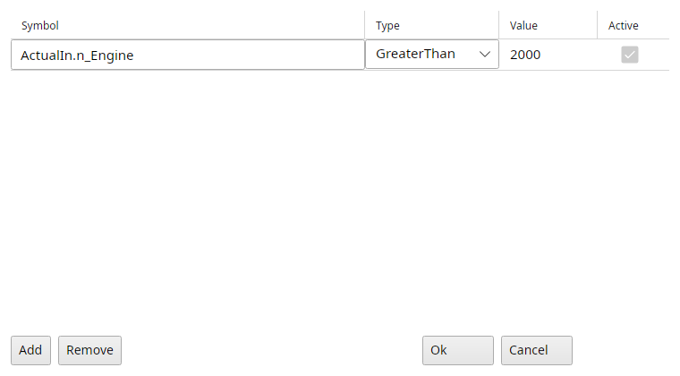
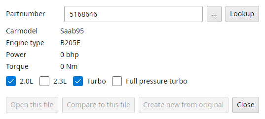
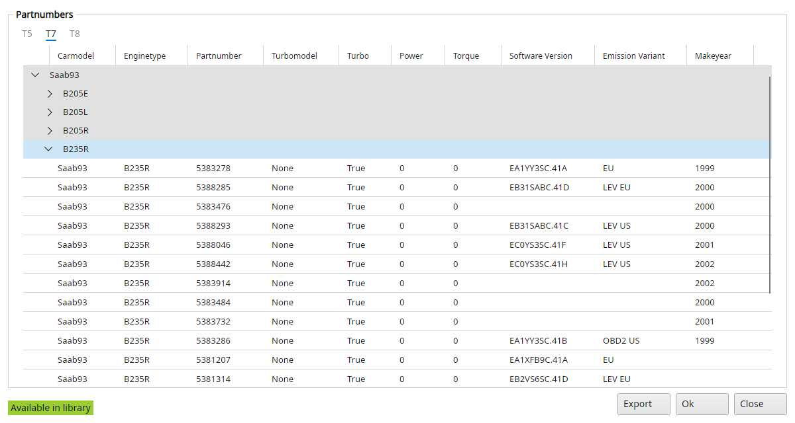

# File menu

The File menu opens, saves, imports and exports files, and holds Settings, Lookup partnumber and the Project submenu.

## File → Open file...

Lets you choose a binary file on your computer, or a Motorola S19 file which is converted first.
TxSuite picks the ECU by the file and extracts all the relevant information from it, see Opening a file in The main window chapter.

## File → Recent

Shows you a list of recently opened files for easy access, of all three ECU's in one list.

## File → Save all

Normally TxSuite saves a map when you close its viewer and say Yes.
If you have map viewers with changes open you can save all of them to the file at once with this option.

## File → Save as...

This lets you choose a different location and/or filename for the binary file you currently have open.
Then TxSuite asks whether to open the copy, Yes and you work on the copy.

::: {.content-hidden when-profile="t5-manual"}
## File → Export to S19

This allows you to save the binary file in Motorola S19 format which can be used to program the ECU with a BDM interface.
:::

## File → Create backup file

Lets you create a backup file for the binary at this point.
It is wise to create backups before you start to make big changes to your file.
If a project is opened, the backup file will be stored within the project folder, otherwise it will be stored in the folder where the bin file is located.

::: {.content-hidden when-profile="t5-manual"}
## File → Import XML descriptor, AS2 descriptor and CSV descriptor

Lets you import the symbol names for a binary from an XML, AS2 or CSV file.
Binaries without a symbol table can be user-described, and if you have a descriptor for your binary file you can import it with these.
The names show in the symbol list at once and are saved next to the bin in `<bin>.xml`.
The Tuning menu is rebuilt with them.

## File → Import tuning package

Lets you import a tuning package which holds generic map information.
TxSuite writes the package's maps into the open file and shows what it did in Import results.
A map whose length in the package differs from the file's is not written.
:::

::: {.content-visible when-profile="t7-manual"}
T7 tuning packages are `.t7p` files.
:::

::: {.content-visible when-profile="t8-manual"}
T8 tuning packages are `.t8p` files.
:::

::: {.content-hidden when-profile="t5-manual"}
## File → Edit a tuning package

If you want to remove maps from a tuning package or you want to add maps, you can edit the tuning package with this option.
It starts empty.
Open package... loads the maps of a package, Add selected symbols adds the symbols selected in the symbol list, Remove (or Del) drops rows.
Each row's map opens in a map viewer that saves into the row, and the result is saved as a new package.
:::

::: {.content-visible when-profile="t8-manual"}
## File → Create binary from TIS file

SAAB has stored Trionic 8 application files in its Technical Information System (TIS).
These files have an extension .gbf and they only contain a part of the complete binary file.
To make things worse, these files are encrypted as well.
Lucky for you, TxSuite can decrypt and build a new binary file for you based on another binary file and a compressed gbf file.

The new file gets the bootloader and adaption data of the base binary and the program of the TIS file.
A `.gbf` or `.s19`, gzipped or not, is taken.
:::

::: {.content-hidden when-profile="t8-manual"}
## File → Compare to original file

If you have a file opened and TxSuite has the original file it was made from, this option will be enabled.
It allows quick access to the changes that were made to the opened binary file, the result is the same list as Actions → Compare symbols with other binary.
The original files are the stock binaries from TxExtras, in TxSuite's `Binaries` folder.
:::

## File → Setup log filters

The realtime panel logs everything it reads.
With log filters you tell TxSuite which lines of a log to keep, for example only the lines above a certain rpm, so you only look at what's relevant.

{#fig-log-filters-t7 width=75%}

Each filter has a symbol, a type (GreaterThan, SmallerThan or Equals), a value and whether it's active.
A line is left out when an active filter doesn't hold for it.
The filters are applied in the log viewer and in both log exports, the logfile itself keeps everything.

## File → Generate Idc file

Writes an IDC script with the symbol names of the open file, for disassembling the binary in IDA Pro.
If you're not sure what that means, you don't need this.

## File → Settings

This option lets you alter the settings that control the behaviour of the application.
They have a chapter of their own, Settings.

## File → Lookup partnumber

Lets you look up a partnumber and the stock binary that belongs to it.
It finds the partnumbers of all three ECU's, whichever file is open.

{#fig-lookup-partnumber-t7 width=55%}

In this screen you can either enter a known partnumber and click Lookup, or click the "..." button to browse all known partnumbers.
TxSuite shows the car model and engine type the partnumber belongs to, and for a T5 or T7 partnumber the power and torque too.

When the stock binary is in TxSuite's `Binaries` folder (TxExtras) you can use it:

Open this file
:   Opens the stock binary.

Compare to this file
:   Compares the open file to the stock binary, only for a partnumber of the open file's ECU.

Create new from original
:   Saves a copy of the stock binary under a name you choose and opens it, a clean start for a new tune.

The "..." button shows every known partnumber with a tab per ECU, the open file's ECU selected.
The list is grouped by car model and engine type, every group starts folded.
The partnumbers that have a stock binary in the `Binaries` folder are coloured.
Double-click a row, or select it and click Ok, to look it up.
Export saves the list as tab separated text.

{#fig-partnumber-list-t7 width=100%}

::: {.content-visible when-profile="t5-manual"}
## File → User library

Your own library of T5 binaries next to the stock ones.
Add files scans a folder for T5 bins and lists each with what TxSuite guesses about it: tuning stage, injectors, map sensor, torque, E85, T7 valve, partnumber, software, CPU speed and RAM lock.
Open selected opens a file, Compare to selected compares it to the open file, and Clear library empties the list.
The library is kept in `UserLib.json` in the `T5` folder of TxSuite's settings folder.
:::

## File → Project

The Project submenu lets you work on your tune in a project, with roll-back and roll-forward, versions and a logbook.
It has a chapter of its own, Projects.

## File → Exit

Come on Einstein, what would that do?

Closing TxSuite asks about maps with unsaved changes first, and it won't close while an ECU is being read or flashed.
