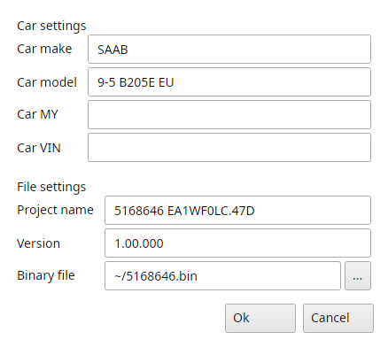
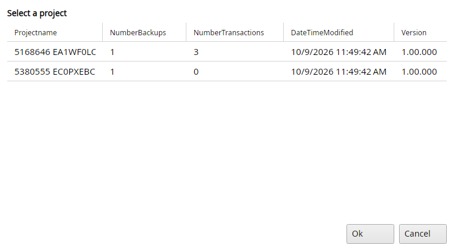
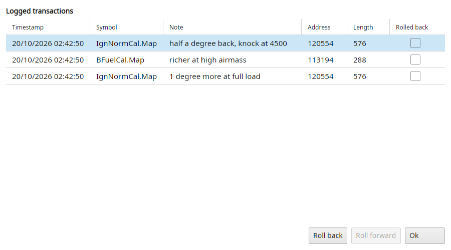
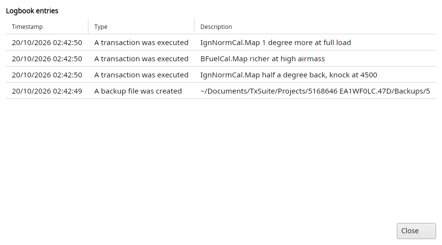

# Projects

TxSuite allows you to work on your tune in a project based fashion.
Projects have the advantage of having roll-back and roll-forward functions, having versioning and keeping things tidy and together.
You are advised to work in a project if you do more than simple easy-tune your binary file.

A project is a folder with a copy of its binary, the transaction log of every change made to it, a logbook and the backups.
The projects are in File → Settings → Common → Project folder, the same folder for all three ECU's.
Every time a project opens TxSuite makes a backup of its binary first.

All project items are in the File → Project submenu.

## File → Project → Create a project

This option lets you create a new project from the binary you have open.
The dialog is filled in from the open file, the binary is copied into the new project folder.

{#fig-project-create-t7 width=45%}

## File → Project → Open a project

Lets you select and open a previously created project.
The list shows each project's number of backups and transactions, when it was last changed and its version.
If no projects are available (none were created before) TxSuite will notify you with a message box.

{#fig-project-open-t7 width=75%}

Opening a plain file closes the project.
With File → Settings → Common → Auto load last file on startup the last project reopens when TxSuite starts.

## File → Project → Close project

Closes the project and allows you to work on single files again.

## File → Project → Show transaction log

Shows the transaction log for the current project.
Since a project contains only one binary file, you could see this as an undo/redo list for the project binary file.
Each row is one write to the binary: when, which symbol, your note, the address and length, and whether it was rolled back.
You can roll back or roll forward any entry from here, and type a note for it.

{#fig-transaction-log-t7 width=90%}

When the log grows past 2000 entries TxSuite offers to purge it.

With File → Settings → Common → Request project notes on, TxSuite asks you for a note every time a change is saved in a project.
This way, you can keep track of changes very easily.

## File → Project → Roll back/undo

Lets you rollback the last transaction made to the binary file.
If no transactions are available to rollback, the item will be disabled.

## File → Project → Roll forward/redo

Lets you roll forward (redo) the last transaction that was undone/rolled back.
If no transactions are available to roll forward, the item will be disabled.

## File → Project → Rebuild file

This enables you to rebuild a project file (binary) up to a certain point in time.
TxSuite will ask you for a date and it will restore (if possible) the file that you had at that specific date.
Store result as current project file puts it in the project, otherwise TxSuite asks where to save it.

## File → Project → Edit project

Lets you edit the properties of the open project.
This enables you to manage your version numbering yourself.
Version numbers are stored, together with all other project properties, in the xml file in the project folder.
Renaming the project renames its folder too.

## File → Project → Add note to project log

You can add a note to your project with a timestamp attached to it, so you can keep track of changes you made in your setup.
For example, if you start using different injectors or mount a bigger intercooler, you can enter a note of this into the project log for later reference.

## File → Project → Show project logbook

Shows you in detail what has happened in your project.

{#fig-project-logbook-t7 width=90%}

## File → Project → Produce latest binary

Lets you export the project binary in its current state so you can save it in another location easily.
