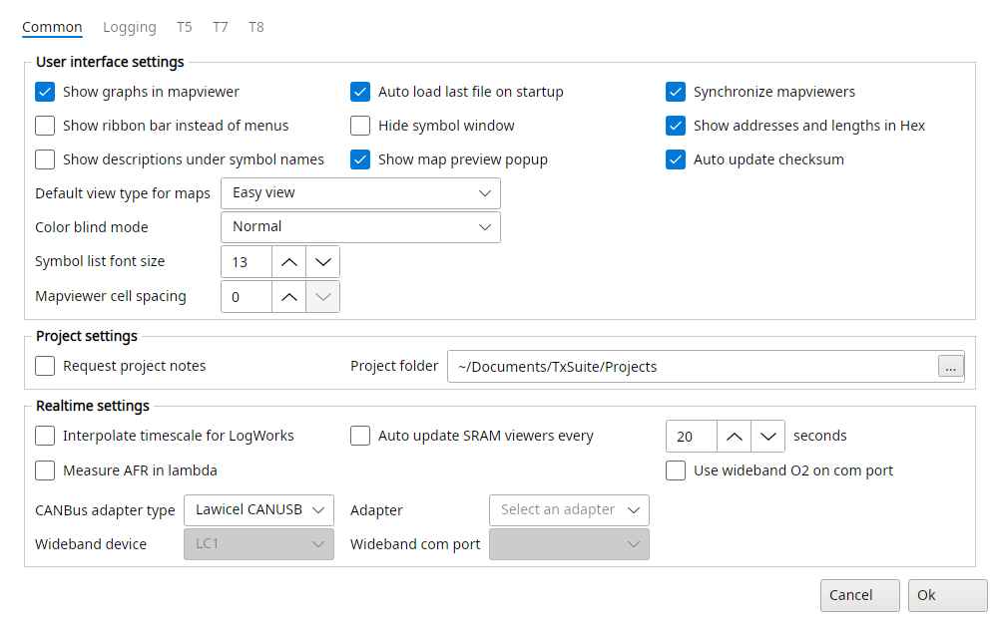
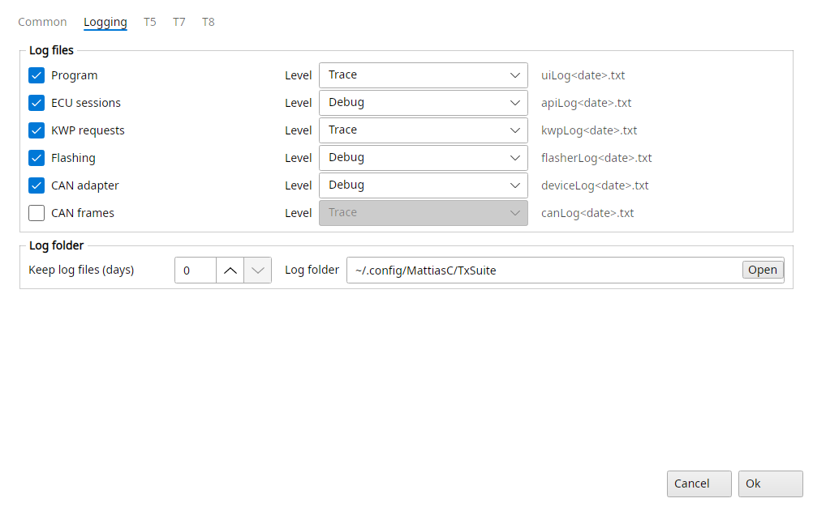

# Settings

File → Settings opens one dialog for every ECU, with the tabs Common, Logging, T5, T7 and T8.
Common and Logging hold what every ECU has, each ECU's tab the options only that ECU has.
Ok applies every tab at once, also to a file that is open.

Hover over an option for a tip on what it does.

::: {.content-visible when-profile="t5-manual"}
This chapter has the Common and Logging tabs, the T5 tab is in the next chapter.
The T7 and T8 tabs are in their manuals.
:::

::: {.content-visible when-profile="t7-manual"}
This chapter has the Common and Logging tabs, the T7 tab is in the next chapter.
The T5 and T8 tabs are in their manuals.
:::

::: {.content-visible when-profile="t8-manual"}
This chapter has the Common and Logging tabs, the T8 tab is in the next chapter.
The T5 and T7 tabs are in their manuals.
:::

## Settings → Common

{#fig-settings-common-t7 width=100%}

### User interface settings

Show graphs in mapviewer
:   To gain performance in lightweight computers you can switch off the graphical display in the map viewer altogether with this option.

Show ribbon bar instead of menus
:   Shows the menus as a ribbon bar at the top of the window, as in the old suites, see The main window.

Show descriptions under symbol names
:   The symbol list shows each symbol's description on a line of its own under its name, as the old T7Suite and T8Suite did.

Auto load last file on startup
:   If you work on one file for a prolonged period of time you might want TxSuite to reopen the last file automatically when you start it.
    If the last opened item was a project, TxSuite will reopen that project for you at start-up.

Hide symbol window
:   To gain more space on the main screen you can hide the symbol list to a tab at the side of the window.
    The tab brings the list out again, and it slides away when you open a map.

Show map preview popup
:   Pointing at a symbol's name in the symbol list shows its map as a read-only table in a popup.

Synchronize mapviewers
:   Map viewers that show the same map follow each other: selecting cells or turning the 3D graph in one does the same in the others.

Show addresses and lengths in Hex
:   TxSuite can display addresses and lengths of symbols in decimal form or in hexadecimal form.
    This option allows you to switch between the two, in the symbol list, the search results and the compare results.

Auto update checksum
:   Having this checked will rid you of the constant worry whether or not the checksum of your file is valid.
    Advised is to keep this turned on!
    With it off TxSuite asks before it corrects a wrong checksum, and before it flashes a file with one.
    Map saves always update it.

Default view type for maps
:   The view type a map opens in: Hexadecimal view, Decimal view or Easy view.
    Easy view is best if you don't know what this means ;)

Color blind mode
:   A colour scale for maps and their graphs that is easier to tell apart with colour blindness: Normal, Universal, Protanopia, Tritanopia or Deuteranomaly.

Symbol list font size
:   The size of the text in the symbol list, 8 to 24 pixels.

Mapviewer cell spacing
:   Space between the cells of a map table, 0 to 20 pixels.
    At 0 they touch as in the old suites.

### Project settings

Request project notes
:   If you are working in a project and you save changes to the binary file, TxSuite will prompt you for a note to describe the change made.
    If disabled, the prompting will be skipped.

Project folder
:   Lets you decide where to store projects (the project root folder), for every ECU.
    You can use this if you want all the projects to be located on a separate disk partition for example.

### Realtime settings

Interpolate timescale for LogWorks
:   LogWorks uses a fixed interval and the frame rate TxSuite reaches differs most of the time.
    Check this option and TxSuite will interpolate the values to match the interval LogWorks works with, when exporting a logfile to LogWorks.

Measure AFR in lambda
:   If you prefer AFR measurements in lambda values instead of AFR values, enable this.

Auto update SRAM viewers every … seconds
:   If you have map viewers open that show the ECU's RAM, TxSuite can refresh them every 5 to 60 seconds while connected.
    This enables you to keep an eye on for example the knock map.

Use wideband O2 on com port
:   Reads a wideband controller on a serial port while the realtime panel runs.
    Its reading is used as the realtime AFR and is shown and logged as Wideband.
    It overrides the wideband through an ECU symbol on the ECU's tab.

CANBus adapter type
:   Lets you choose which CAN bus interface you have: Lawicel CANUSB, Kvaser HS, CombiAdapter, OBDLink SX, OBDLink EX, J2534, Just4Trionic, SLCAN or ELM327.

Adapter
:   Which adapter of that type to use.
    For an OBDLink, ELM327, Just4Trionic or SLCAN adapter this is its serial port.
    The CombiAdapter is found by itself, so the list stays empty for it.

Serial speed
:   The speed of the serial connection to an ELM327 or a Just4Trionic.
    It shows for SLCAN too, but SLCAN adapters always use 3000000 baud.
    The OBDLink SX and EX pick their speed themselves.

Wideband device
:   The type of wideband controller on the wideband com port: PLX, LM1, LC1, LM2, ZT2, AEM, STAG or LambdaShield.

Wideband com port
:   The serial port the wideband controller is connected to.

## Settings → Logging

TxSuite writes log files of what it does, a file per log and per day.
They are what to post when something doesn't work.

{#fig-settings-logging-t7 width=100%}

Each log can be turned on or off and gets a level of its own.
Trace logs everything, Debug a little less, then Info, Warn and Error.
A level also logs every one after it, so Error logs the errors alone.

Program
:   What TxSuite and its T5, T7 and T8 parts do: opening and parsing binaries, symbols, checksums, settings, the realtime panel.

ECU sessions
:   The T5, T7 and T8 sessions: connecting, security access, reading and writing memory, fault codes.

KWP requests
:   Every KWP2000 request to a T7 and its answer.

Flashing
:   Reading and flashing an ECU's flash, block by block.

CAN adapter
:   The adapter's driver: opening it, its settings, the frames it couldn't send, its errors.

CAN frames
:   Every CAN frame sent and received.
    It grows fast and slows the communication down, for finding communication problems only.
    Off by default, it is the old suites' Enable canbus logging.

Keep log files (days)
:   Log files last written longer ago than this many days are deleted when TxSuite starts and when the settings are saved.
    0 keeps them all.

Log folder
:   Where the log files are, its Open button opens the folder.
