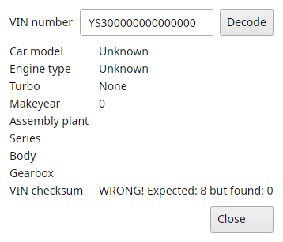
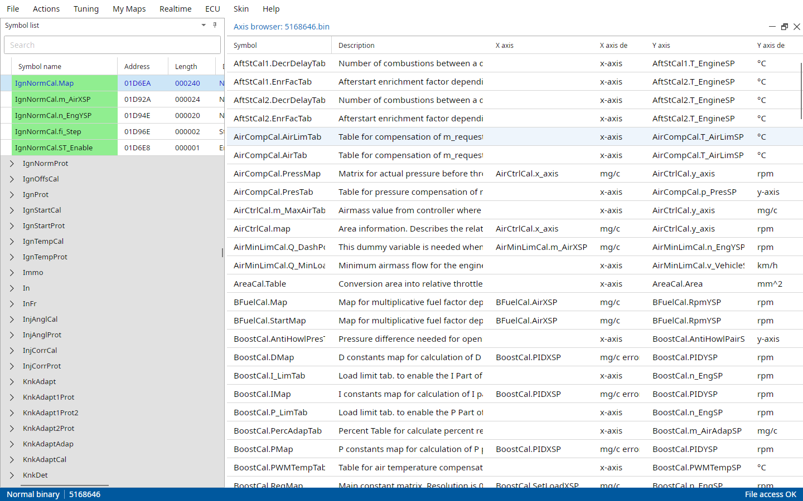
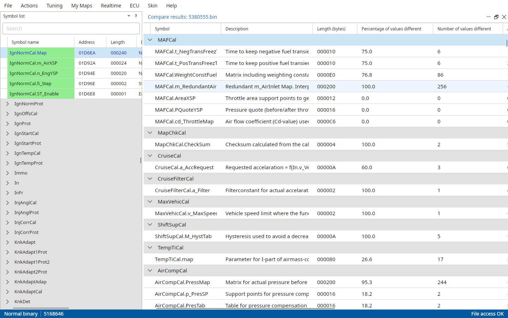
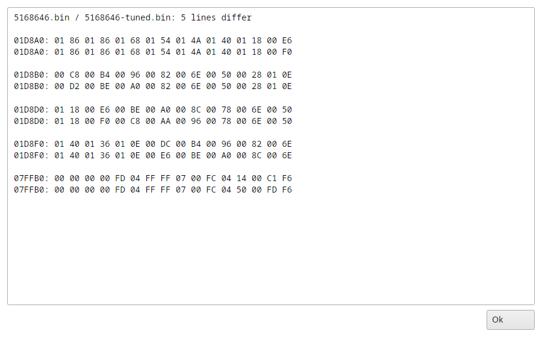
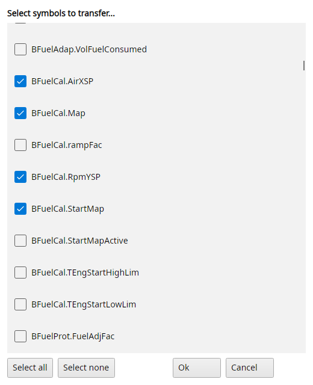
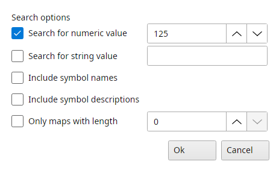
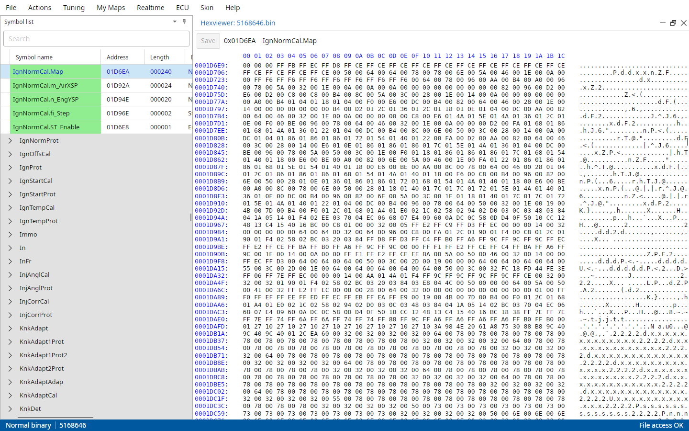

# Actions menu

The Actions menu has the checksum, the information about the open file, the compare and transfer tools and the SRAM snapshots.
Its last section, the tools, is different for every ECU and is described in the chapters after this one.

## Actions → Verify checksum

::: {.content-visible when-profile="t5-manual"}
Checks the checksum of the open file and shows the result in the status bar, "Checksum: OK" or "Checksum: invalid".
This will not be needed if the auto checksum update function is turned on.
:::

::: {.content-visible when-profile="t7-manual"}
If you don't have the automatic checksum routine turned on, you can manually verify and correct the file's checksum with this option.
TxSuite says "Checksums verified and all matched!" or "Checksums did not verify ok!".
With File → Settings → Common → Auto update checksum on, a wrong checksum is corrected straight away, with it off TxSuite asks whether to recalculate it.
:::

::: {.content-visible when-profile="t8-manual"}
Checks both checksum layers of the open file, the same way as when it opens.
The status bar shows the result, "Checksum: OK" or which layer is invalid.
With File → Settings → Common → Auto update checksum on a wrong checksum is corrected, otherwise TxSuite asks per layer.
:::

## Actions → Firmware information

::: {.content-visible when-profile="t5-manual"}
Lets you view and modify a lot of parameters in the ECU, T5Suite's Trionic options.
It has a chapter of its own, Firmware information.
:::

::: {.content-hidden when-profile="t5-manual"}
Lets you see and alter the settings for the current binary file.
It has a chapter of its own, Firmware information.
:::

## Actions → VIN decoder

Lets you decode SAAB VIN numbers into readable format, from car model and engine type to gearbox, and checks the VIN's check digit.

::: {.content-visible when-profile="t5-manual"}
A T5 file holds no VIN, so it opens empty.
:::

::: {.content-hidden when-profile="t5-manual"}
It opens with the VIN stored in the open file.
:::

Type a VIN and press Enter or click Decode.

The picture is the stock T7 binary 5168646, it carries a placeholder VIN instead of a car's.
That's why it decodes as Unknown with a checksum error.

{#fig-vin-decoder-t7 width=40%}

## Actions → Browse axis information

Shows you the relations between maps and axis symbols.
This is very informative to browse and learn.
Double-click a row to open its map, or the axis you clicked on.
The symbol menu's Browse axis information opens it at that symbol.

{#fig-axis-browser-t7 width=100%}

## Actions → Show interrupt vectors

This is a little tool for techies.

::: {.content-hidden when-profile="t8-manual"}
It shows the start-up vector information for the Motorola MC68332 microprocessor.
:::

::: {.content-visible when-profile="t8-manual"}
It shows the start-up vector information for the Motorola MC68377 microprocessor.
:::

## Actions → Show disassembly

Lets you disassemble the binary file into human readable text format also known as assembler language.
If you're not sure what that means, you don't need this.

The listing is saved next to the bin as `<bin>.asm` and opens in an editor with search and replace.
Next to it are the bin's bytes, the cursor in one follows the other.
When the `.asm` file already exists TxSuite asks whether to make it again.

::: {.content-hidden when-profile="t5-manual"}
## Actions → Show full disassembly

Disassembles the whole file from start to end, code or not, into `<bin>_full.asm`.
:::

## Actions → Compare symbols with other binary

The most time-consuming thing is comparing maps for different firmware versions by hand.
TxSuite gives you the tools to compare maps in different binaries with a click of the mouse.
Comparing binary files (actually the maps inside them) is a very educational activity, you will see which maps are different in for example B234L and B234R engine types.

To do this you must first open the primary binary you want to compare.
Then, select Compare symbols with other binary and select the secondary binary you wish to compare the first one with.
TxSuite will now display a list of symbols that differ in the selected binaries, grouped by category.
The list shows how many values differ, the percentage and the average difference.
Symbols that only one of the files has are coloured and say in which file they're missing.

{#fig-compare-results-t7 width=100%}

Double-clicking a symbol in this result list opens its map from both files, in one window with a tab per file.
Right-click a symbol for more:

Open
:   The same as a double-click.

Show differences map
:   One map with the difference between the two files.

Export to CSV
:   Saves the result list as a CSV file.

::: {.content-hidden when-profile="t5-manual"}
Export as tuning package
:   Saves the selected symbols, from either file, as a tuning package.
:::

::: {.content-visible when-profile="t5-manual"}
You can select several files to compare to.
TxSuite then shows a Compare list first, with the number of differing symbols per file, Enter or a double-click shows the results of that file.
:::

::: {.content-visible when-profile="t8-manual"}
## Actions → Compare binary outside symbolrange

Compares the bytes of the two files that are not in any symbol, the code and everything else the symbol table doesn't describe.
:::

## Actions → Compare binary with other binary

Lets you do a binary (byte-by-byte) compare of two files.
This is a good tool to verify whether a programming session was successful or not.
Sequences of steps would be:

1. Program ECU
2. Read file from ECU
3. Compare original and downloaded file with Compare binary with other binary.

If it says 0 lines differ the files are identical (successful programming).

{#fig-binary-compare-t7 width=90%}

## Actions → Transfer maps to another binary

If you have a set of tuned maps in one binary file and you want to have them transferred to a different base file, you can use this function.
The wizard asks for the target file and shows a list of symbols to choose from, it remembers your last choice.
A backup of the target is made before anything is written, and a report shows what was done.

::: {.content-visible when-profile="t5-manual"}
Please note that different base files might have different map sizes and TxSuite might be unable to transfer them.
[Exchanging data between T5.5 and T5.2 and v.v. is very dangerous!]{.underline}
:::

{#fig-transfer-maps-t7 width=50%}

::: {.content-hidden when-profile="t5-manual"}
## Actions → Copy address table to another binary

Some tuning companies choose to damage information inside the binary file to prevent users to have a look at them.
Mostly the address table is damaged.
With this option you can easily copy the address table from a MATCHING file (original file) to the corrupted file.
The target's checksum is updated too.
If you don't know what this is about, please don't use it!
:::

## Actions → Search map content

Allows you to search maps for a specific value, a number (as shown in Easy view) or a text.
It can search the symbol names and descriptions too, and only maps of a given length.
The result will be shown in a list, double-click a row to open its map.

{#fig-search-maps-t7 width=45%}

## Actions → Export map to CSV

Saves the map selected in the symbol list to a CSV file, which opens in Excel or any other spreadsheet.
It replaces the old suites' Excel export.
The file is named `<bin>~<symbol>.csv`.

::: {.content-visible when-profile="t5-manual"}
## Actions → Import map from CSV

Reads a map back from a CSV file, the other way around.
A file named `<bin>~<symbol>.csv` goes into that symbol after asking, otherwise into the map selected in the symbol list.
:::

## Actions → View file in hex

Lets you explore the binary file in hexadecimal form (advanced users!)
The symbol under the cursor is shown.
You can change bytes and save them in place, TxSuite makes a backup copy first and asks about unsaved changes when you close it.
A loaded SRAM snapshot can be viewed in hex as well.

{#fig-hex-view-t7 width=100%}

## SRAM snapshots

An SRAM snapshot is a dump of the ECU's working memory (`.RAM`).
It holds the maps that only live in RAM and what the ECU learned (adaption), and while you tune live the changes that aren't in the file yet.
ECU → Get SRAM snapshot makes one.

### Actions → Import SRAM snapshot

Loads an SRAM snapshot for the open file.
Symbols that only live in SRAM then open from it, and the symbol menu's Read from SRAM file shows a map as it was in the snapshot.
The status bar shows the loaded snapshot.

::: {.content-hidden when-profile="t8-manual"}
### Actions → Compare binary to SRAM snapshot

Compares the open binary file to an SRAM snapshot and shows what the ECU has learned (adapted) so far OR which changes you've made in realtime to the ECU which are still stored in SRAM.
The result is a difference list from which you can choose to view the separate maps.

### Actions → Compare SRAM snapshots

Lets you compare two different SRAM snapshots from the ECU to see which settings were altered, either by you or the ECU itself (adaption).
The result is a difference list from which you can choose to view the separate maps.
:::

::: {.content-visible when-profile="t5-manual"}
### Actions → Binary compare SRAM snapshots

Mostly for exploration of SRAM dump files.
You can use this function to find the byte differences in two SRAM files.

### Actions → Import SRAM snapshot into binary

This allows you to import the most important adaption data into the binary file from an SRAM dump that you made from the ECU after it has been allowed to adapt.
You can choose which items to import (use with caution, advanced users only!)
:::
