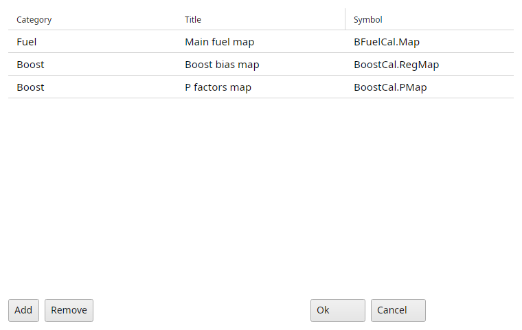

# My Maps menu

My Maps is your own menu of the maps you use most, so they are one click away.
Each ECU has its own, the menu shows the open file's ECU's maps.

## My Maps → Define myMaps...

Opens the list of your maps, a row per map with its category, title and symbol.
Add and Remove change the list, Ok saves it.
The first time the list starts with the old suite's defaults for that ECU.

{#fig-my-maps-t7 width=75%}

Below Define myMaps... the menu has a submenu per category, with its maps.
A map entry opens that map of the open file.

The symbol menu's Add to MyMaps adds the selected symbol to the list.

The list is kept per ECU in `mymaps.xml` in TxSuite's settings folder, the first start takes over the old suites' lists.
