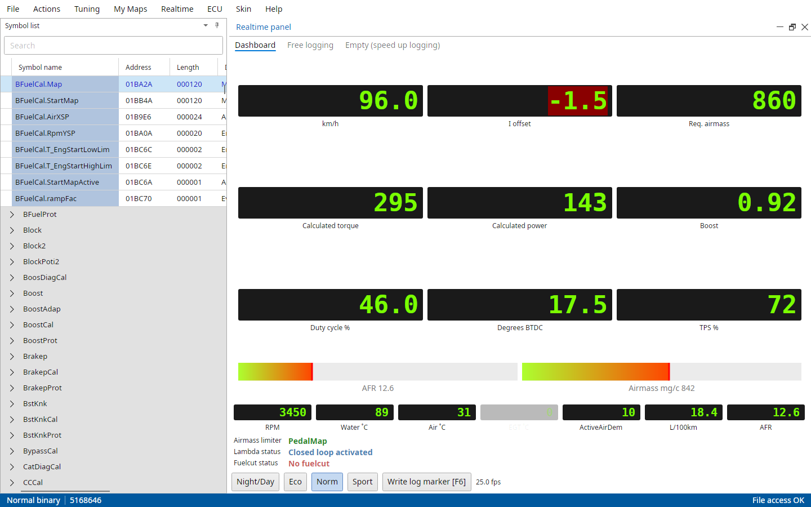
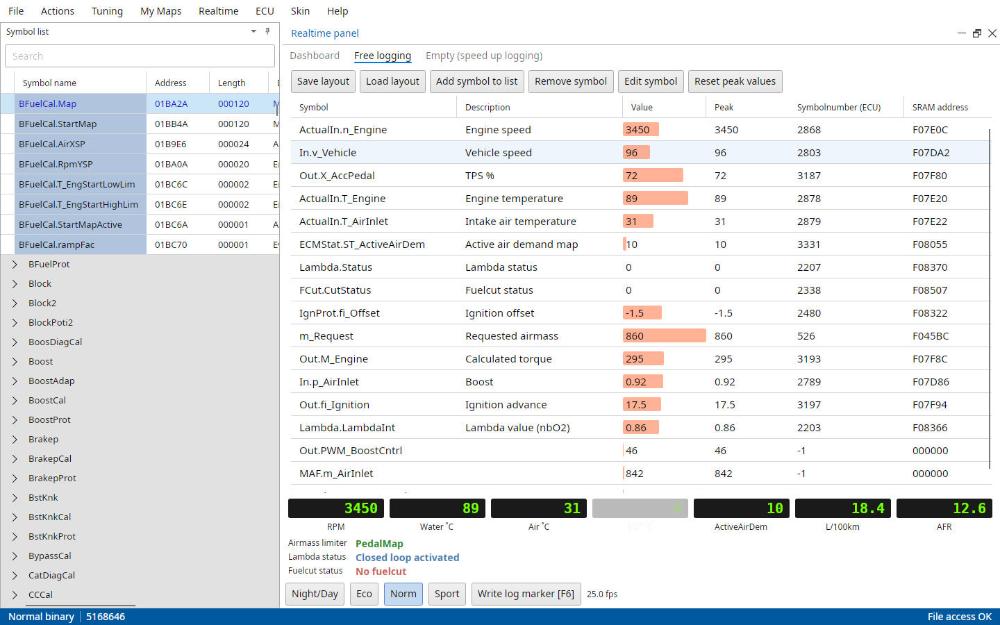
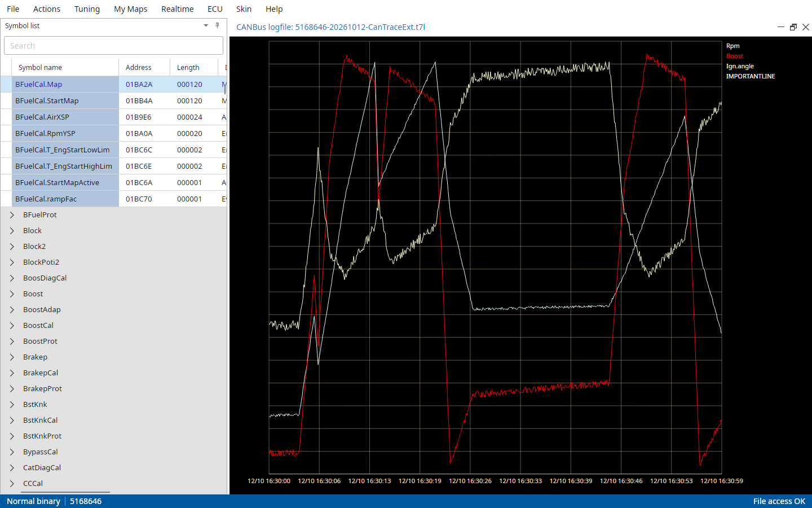
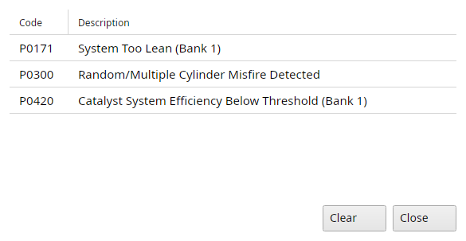

# Realtime menu

The Realtime menu connects to the ECU, runs the realtime panel and works with its logfiles.
The ECU must be connected through one of the interfaces in Supported interfaces, set up in File → Settings → Common.
A file of the ECU must be open, it tells TxSuite which ECU it's talking to.

::: {.content-visible when-profile="t5-manual"}
Realtime sessions on a T5 only run over CAN (the P-bus), not over BDM!
:::

The items only your ECU has are described in the next chapter.

## Realtime → Connect ECU

Connects to the ECU, the item then reads Disconnect ECU.
The status bar shows the connection.
Map viewers opened while connected show the ECU's data, see Maps from the ECU in Working with maps.

::: {.content-visible when-profile="t5-manual"}
If the ECU and the binary file are not in sync, TxSuite will ask you if you want to resynchronize, see Data synchronization in the next chapter.
:::

## Realtime → Toggle realtime panel

Allows you to start a realtime session [Shift+F1].
If all connections are done well, TxSuite should be able to connect to the ECU and show you realtime information.
Toggling it again stops the panel.

While the panel runs it logs every value it reads into a logfile next to the bin, one per bin and day: `<bin>-yyyyMMdd-CanTraceExt` with the ECU's log extension.

::: {.content-visible when-profile="t5-manual"}
The T5 realtime panel is described in the next chapter.
:::

::: {.content-hidden when-profile="t5-manual"}
{#fig-realtime-dashboard-t7 width=100%}

The panel has three tabs.

Dashboard
:   The most important values as displays: rpm, temperatures, boost, airmass, torque, power, ignition, throttle and more.
    The AFR display switches between AFR and lambda when you click it.
    Below are the airmass limiter, lambda status and fuelcut status.

Free logging
:   Your own list of symbols with their value and peak value.
    Add symbol to list, Edit symbol and Remove symbol (or Del) change it, Ctrl+Up and Ctrl+Down move a symbol up or down.
    Save layout and Load layout keep a list for later, Reset peak values starts the peaks over.
    The symbol menu's Add to realtime list adds a symbol from the symbol list.

Empty (speed up logging)
:   Shows nothing, so all the time goes to reading and logging.

{#fig-realtime-free-logging-t7 width=100%}

Night/Day switches the panel to dark colours for driving at night.
Write log marker [F6] writes a marker into the log.

Open map viewers of the main fuel, ignition and boost maps show the cell the engine is in, in yellow.
:::

## Realtime → Export logfile to LogWorks

Will convert and export a logfile to LogWorks format (`.dif`).
You choose the symbols and the time range to export in "Logfile data selection".
It lists every symbol of the log, all ticked, with Select all and Select none.
From time and Up to time start at the beginning and the end of the log.
TxSuite doesn't start LogWorks, open the file in it yourself.

## Realtime → Load logfile

Loads and shows a logfile in TxSuite's log viewer.

{#fig-log-viewer-t7 width=100%}

A log is split into sections where it has a gap of more than 10 seconds, you pick the section first.
The channels are drawn over each other, each scaled to its own range, in the colours of Set symbol colors.
The legend shows the values under the cursor.
The mouse wheel zooms, dragging moves along, and the arrow keys do the same.

## Realtime → View matrix from logfile

Lets you view three channels in a logfile displayed as a surface graph (matrix).
Choose the symbols for the x axis, the y axis and the value, and whether a cell gets the mean, the minimum or the maximum of its values.
The result is a 16 × 16 map between the smallest and largest logged x and y, in a read-only map viewer with its 3D graph.

## Realtime → Set symbol colors

Lets you choose the colours that will be used for the symbols in the log viewer.
The list has every symbol the ECU has in RAM, with a search box on top.

## Realtime → Get fault codes

::: {.content-visible when-profile="t5-manual"}
Reads all the error code counters in the ECU and displays which error counter holds values greater than zero.
:::

::: {.content-hidden when-profile="t5-manual"}
Allows you to fetch the fault codes (DTC's) from the ECU.
:::

Clear clears the selected fault code, Close closes the window.

::: {.content-visible when-profile="t8-manual"}
On a T8 Clear clears all fault codes in the ECU at once, whichever P code is selected.
:::

{#fig-fault-codes-t7 width=60%}

## Realtime → Write log marker

While running a realtime session this enables you to write a marker in the log which you can track back easily later on [F6].

## Realtime → Export logfile to CSV

Exports a logfile to CSV, with the symbols and the time range you choose in "Logfile data selection", as for LogWorks.
The first column is the time in seconds since the first line.
